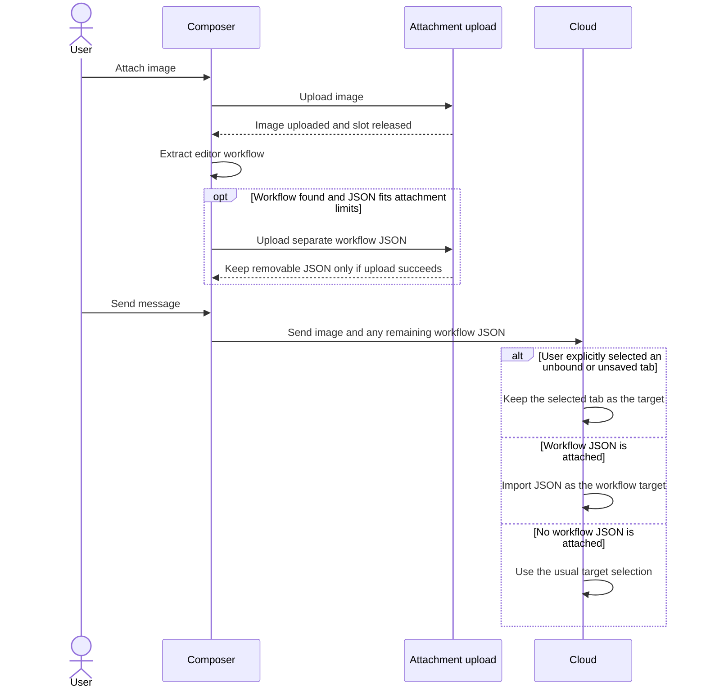

# ADR-AGENT-ATTACHMENTS-lift-embedded-workflows-in-the-composer: Extract embedded workflows in the agent composer

Date: 2026-11-19

## Status

Accepted

## Context

The behavior below applies once
[#23804](https://github.com/Comfy-Org/ComfyUI_frontend/pull/23804) lands.

When you attach an image to an agent message, the agent gets the picture but
can't edit the workflow embedded in it. The workaround is to drop the image on
the canvas to open the workflow there first.

Cloud already imports a workflow attached as a `.json` file. It looks up the
attachment in the caller's scope, validates the ComfyUI save format, and creates
a draft without a version. `read_workflow` and the editing tools can use that
draft without loading it onto the canvas.

## Decision

When you attach an image that contains a ComfyUI editor workflow, the browser
uses its existing metadata parsers to extract the workflow. It adds a separate,
removable `.json` attachment and uploads it through the usual attachment
endpoint. Cloud imports it like a workflow file you attached yourself. This
requires no backend change or second parser.

The browser waits for the source image upload to finish before extracting the
workflow. If image uploads held their slots while waiting for the JSON uploads,
a full set of concurrent image uploads could deadlock. The extra attachment
uses a filename so the change needs no new entry in the shared translation
catalog. If the browser can't extract or attach the JSON, the image attachment
is unaffected and the composer shows no warning about the missing workflow.

The browser extracts editor-format `workflow` metadata only. If the image
contains just an API-format `prompt`, the browser leaves it alone. Reconstructing
an editor graph from that prompt would invent a layout and omit groups and
reroutes, so
[BE-4259](https://linear.app/comfyorg/issue/BE-4259) requires product sign-off
before offering it. PNG `zTXt` remains unsupported by both attachment extraction
and canvas drop.

The image upload releases its slot before the composer starts a second upload.
Cloud chooses the workflow target only when the message is sent.

## Alternatives considered

- A Go reader in the runtime could also support tool calls, assets the agent
  finds in the library, and headless clients. The runtime already fetches
  assets in Cloud and local deployments, and its location stripper has
  fuzz-tested code for reading several image containers. A Go reader would
  still duplicate the browser parser and need shared fixtures to keep their
  results consistent.
- A published `@comfyorg/workflow-metadata` npm package could serve JavaScript
  and TypeScript consumers, but the Go runtime can't import it directly.
- A shared WebAssembly parser would keep one implementation, at the cost of a
  larger bundle, a more complex build, and replacing the working browser parser.
- The runtime already invokes comfy-cli for workflow operations, so
  `comfy workflow extract` could have used that subprocess. The CLI project
  declined the scope in
  [comfy-cli#341](https://github.com/Comfy-Org/comfy-cli/issues/341).

The upload service preserves ComfyUI's `workflow` and `prompt` metadata
byte-for-byte while stripping GPS and XMP metadata. CI checks this on the stored
object. In the formats examined, `ffprobe` returned tags for audio and video
files but missed them in PNG, WebP, and AVIF, so it wouldn't cover the common
image case.

## Consequences

On send, the agent usually works on the attached workflow instead of the active
canvas. An explicitly selected unbound or unsaved tab still takes precedence
under [cloud#17623](https://github.com/Comfy-Org/cloud/pull/17623). You can remove
the JSON before sending if you want to keep working on the active canvas.

The JSON takes a second attachment slot and appears in the Assets tab as an
input asset. If there's no slot for the JSON, the image still attaches without
a warning about the missing workflow. If the generated files clutter the Assets
tab, a follow-up could tag and filter them.

Extraction works only for assets attached in the browser. Agent tool calls,
library assets the agent finds on its own, and headless or MCP clients would
need a runtime reader.
