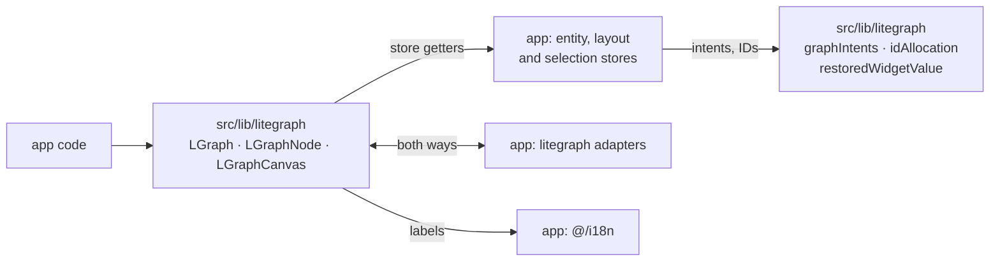
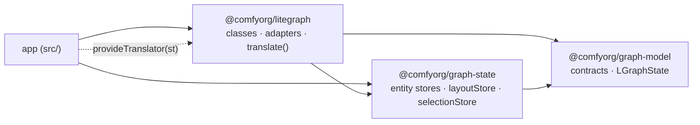
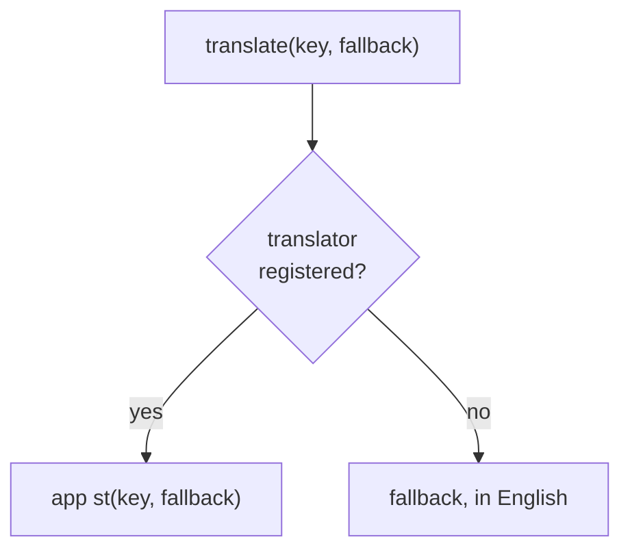

# ADR-ECS-PACKAGES-0051: Entity stores sit below litegraph

Date: 2026-10-29

## Status

Accepted

## Context

Litegraph is the last large near-leaf in `src`: the app imports it everywhere,
and it imports a small set of app modules back. Those back-imports keep it from
becoming a declaration-backed package (ADR-DEVEX-BUILD-0011). Its graph
contracts and telemetry have already moved to `@comfyorg/graph-model` and
`@comfyorg/telemetry`.

A dependency-cruiser pass over litegraph's non-test sources on the date above
sorts the remaining app imports into four groups:

- **Entity stores.** The link, link presentation, link selection, reroute,
  widget value, node data, graph metadata, execution order, entity ID, preview
  exposure and canvas selection stores. Also the layout store and its
  mutations, plus the store-teardown and graph-rekey helpers.
- **Litegraph adapters in app directories.** These are the selection adapter,
  slot calculations, link adapter, legacy render arrangement, graph layout
  attachment, auto-pan, node shell lifecycle and state, promoted-widget
  adoption, and link-presentation transfer. Most import litegraph and are
  imported by it. The rest have no consumer besides litegraph.
- **Leaf helpers and types.** Promoted-widget resolution, selection state and
  intent, layout types and math,
  viewport and polyline geometry, UUID generation, widget visibility, slot
  colours, pointer utilities, `assert`, graph traversal, schemas, and the badge,
  DOM-widget, node-definition and execution-output types.
- **`i18n`.** A few context-menu and widget labels are translated, and importing
  `@/i18n` loads the English locale files.

The transitive closure of these modules contains no Vue component, view or app
service. Its third-party dependencies are Vue reactivity, Pinia, Yjs, vue-i18n,
zod, es-toolkit, loglevel and VueUse.

The stores reach litegraph only through small leaves:

- the graph-intent bus;
- restored-widget-value coercion;
- ID allocation;
- unique-name generation;
- the `litegraph()` singleton accessor, which the layout code reads for node
  metrics.

The stores and litegraph import each other, so neither can leave `src` alone:

Litegraph classes call store getters directly throughout the class layer. An
active Pinia is already required before the first graph exists: `main.ts`
installs it before extensions load, and the Vitest setup installs a testing
Pinia for every test. Packages already own Pinia stores (`keybindings`,
`mask-editor`).

The payoff is a dependency boundary, not compile speed. A declaration what-if
that excluded litegraph from the app program cut stock vue-tsc check time by
about 3% and did not change native typecheck wall time.

## Decision

1. **The entity stores move into a new declaration-backed package,
   `@comfyorg/graph-state`, which sits below litegraph.** The dependency order
   is `graph-model → graph-state → litegraph → app`. Graph-state owns:
   - the Pinia stores that hold ECS entity data (ADR-ECS-0008);
   - the layout store and its mutations (ADR-CRDT-LAYOUT-0003,
     ADR-CRDT-LAYOUT-0046);
   - the canvas selection store (ADR-CANVAS-SELECTION-0028);
   - their teardown and rekey helpers.

   It depends on graph-model, telemetry, Vue, Pinia and Yjs, and never on
   litegraph.

2. **Litegraph keeps importing the stores directly.** It adds no injected
   registry and no construction ports. A store getter resolves against the
   active Pinia, which litegraph already requires. The rule that entity data
   lives in dedicated stores, not on class instances, is unchanged; only the
   package that owns the stores changes.
3. **The pieces the stores take from litegraph move down.** The intent bus, ID
   allocation, unique-name generation and restored-value coercion move to
   graph-state, or to graph-model when they are pure functions over contract
   types. The `litegraph()` accessor moves to graph-model unchanged. It is
   already typed through the entity registry and registered by the litegraph
   barrel (ADR-MODULES-ACCESSORS-0046, decision 1).
4. **The adapters move into litegraph.** A module that imports litegraph and
   is imported by litegraph is litegraph code, and so is an app module that
   only litegraph uses. App consumers import adapters from litegraph's exports.
5. **Each leaf moves to the lowest package that all its importers can reach.**
   - Contract types and schemas go to graph-model. The node-definition V2
     schema joins the V1 schema in `@comfyorg/object-info-parser`.
   - Generic utilities go to `@comfyorg/shared-frontend-utils`.
   - Leaves used only by litegraph go into litegraph.

   App-local forwarding modules are deleted rather than kept
   (ADR-GRAPH-TYPES-0050).

6. **Translation becomes a port with fallbacks.** Litegraph translates through
   an accessor shaped like `st(key, fallback)`. Bootstrap registers the app's
   vue-i18n translator. A missing translator is a valid state that returns the
   English fallback, like the scoped registrations in
   ADR-MODULES-ACCESSORS-0046 (decision 5). Every litegraph call site supplies
   its fallback.
7. **Dependency-cruiser enforces the boundary from the first step.** A rule
   lists the app modules litegraph may still import, and each later step only
   removes entries. Once litegraph is a package, the rule forbids every import
   from the package into the app.

The resulting packages form one direction of dependency. The app reaches
litegraph's labels only by registering its translator at startup:

A litegraph label resolves through the port, so a missing translator falls back
to English instead of failing:

## Extension compatibility

- Runtime identity does not change. There is still one `LiteGraph` instance,
  `window.LiteGraph`, and one copy of each entity class, so `instanceof` checks
  keep working.
- The moves relocate modules, not members. Entity callbacks, `node.widgets`,
  `node.serialize` and `graph._version` keep their names, signatures and timing.
- No constructor gains a parameter. Extensions that call `new LGraph()`,
  `LiteGraph.createNode` or subclass constructors keep working.
- `@comfyorg/comfyui-frontend-types` keeps bundling the litegraph and
  graph-model declarations. Store types do not join the extension API.
  Extensions must not import `graph-state` or the litegraph package directly,
  the same rule ADR-GRAPH-TYPES-0050 sets for graph-model.
- The app bundle must resolve exactly one copy of Vue, Pinia and Yjs. A second
  Pinia copy would define stores against a Pinia that the app never activates.
  Packages declare these dependencies from the workspace catalog.

## Alternatives

- **Move the stores into the litegraph package.** This means one package fewer.
  But every data reader, such as the Vue node renderer, the CRDT follower and
  the agent, would then depend on the class layer just to read entity data.
  That runs against ADR-ECS-0008, where systems query stores without classes.
  Apart from the leaves in decision 3, the stores do not depend on the classes.
- **The app owns the stores, and litegraph reaches them through registered
  accessors.** This adds a bootstrap registration and a read-before-register
  failure to every store call site. It breaks a cycle that goes away once a few
  leaves move down. ADR-MODULES-ACCESSORS-0046 keeps accessors for cycles that
  cannot be removed.
- **Pass ports to the graph at construction.** This changes constructors that
  extensions call and override. It would also thread ports through subgraphs,
  `LiteGraph.createNode` and deserialization, which breaks the extension
  contract.
- **Put the stores in graph-model.** Graph-model is a contract leaf without
  reactivity. Adding Pinia and Yjs to it would impose them on schema-only
  consumers such as workflow validation and settings.

## Consequences

- Graph-state needs an active Pinia. Its package tests join the root
  `frontend` Vitest project, whose setup installs a fresh testing Pinia per
  test. The tests import no app module, but that shared setup does, so the
  package tests stay coupled to the app setup until graph-state gets its own
  Vitest project.
- Modules change paths, but their ownership rules (store identity, teardown,
  Y.Doc lifetime) do not.
- The app keeps compiling litegraph's large public types, so typecheck time
  stays roughly the same.

## Implementation

All seven steps landed in one change instead of the sequence first planned:

1. Dependency-cruiser forbids every import from litegraph into the app. The
   allowlist of decision 7 was never needed, because the boundary closed in the
   same change. The litegraph package typecheck has no `@/` alias, so tests are
   held to the same rule.
2. The leaves moved down (decision 5), and the app forwarding modules are gone.
3. Litegraph translates through `provideTranslator` and `translate(key,
fallback)` (decision 6).
4. The adapters moved into litegraph (decision 4).
5. The store back-edges moved down (decision 3). The stores only needed the
   `LGraphState` contract from ID allocation, so that contract went to
   graph-model while allocation and the graph-intent emitters stay in
   litegraph. Graph-state types the owning graph and node structurally instead
   of importing litegraph classes. The `litegraph()` accessor stays in
   litegraph: once the layout store stopped reading node title height, its only
   store-side reader was an app utility.
6. `@comfyorg/graph-state` holds the stores (decision 1). Graph-state tests that
   build litegraph graphs stay in the app.
7. Litegraph is the declaration-backed `@comfyorg/litegraph` package. The app
   imports `@comfyorg/litegraph/*`, and the package imports `#/*`. Litegraph
   tests that exercise app modules live next to those modules.

The types build compiles litegraph from package source, and its output is
unchanged. Contract types that appear in the public surface, such as
`LGraphState`, live in graph-model, and the types consumer check rejects any
`@comfyorg/graph-state` import in the bundle. The architecture records treat
`packages/litegraph/src` as a second source root.
