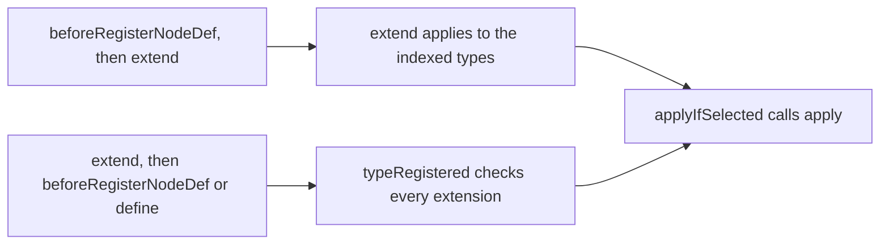
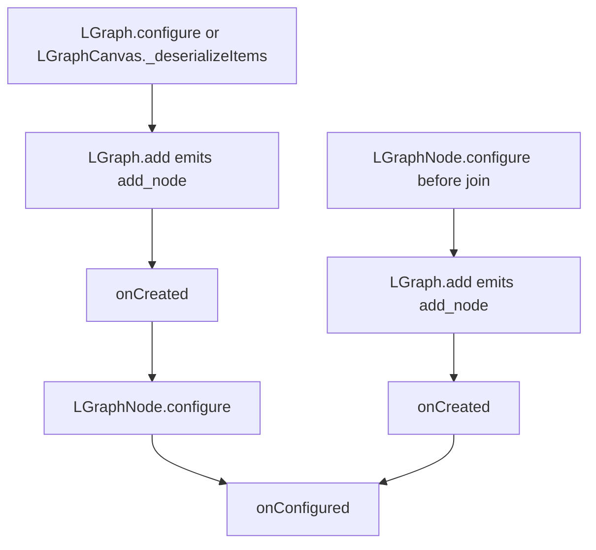

# ADR-EXTENSIONS-NODE-API-0071: Node definitions and the hooks a pack adds to them

Date: 2026-11-12

## Status

Proposed

## Context

Packs work with node types: they read a type's definition, add types of their
own, and add behavior to a type, which today they do in the
`beforeRegisterNodeDef` hook by patching the class the host generates for each
type. In the census of the old contract `Comfy.defs` is the most used member:
112 of 125 stored packs reach it, and 109 call `DefRegistry.extend`.

Two facts shape the API. The host registers node types more than once: at
startup, again for every definition when node definitions reload, and again
when [late custom nodes turn on](EXTENSION-LOADING-0048-late-custom-nodes-turn-on-after-the-editor-opens.md).
And a pack's module may run before or after the types it extends register, so
`extend` cannot depend on the order.

## Decision

Use `comfy.defs` to read node definitions, register a pack-owned type, or add
hooks and menu items to a type. Hooks receive the document-scoped node handles
of [ADR-EXTENSIONS-NODE-API-0070](EXTENSIONS-NODE-API-0070-versioned-node-api-with-document-scoped-handles.md)
instead of patching generated node classes. A pack takes its id from
`comfy.registerPack(import.meta)` (decision 43) and passes it to `define` and
`extend`. Register hooks while the module evaluates: the type can register
before or after the pack, but an extension reaches only nodes that join a
graph after the call. Use `comfy.graph` for nodes already in the graph.

For example, a pack can define a frontend type and add a context-menu action
to it:

```js
import { comfy } from '/comfy/api/v4.js'

const packId = comfy.registerPack(import.meta)
const unregister = comfy.defs.define(packId, {
  type: 'ExampleLabel',
  title: 'Label'
})
const stop = comfy.defs.extend(packId, 'ExampleLabel', (builder) => {
  builder.addMenuItem({
    label: 'Reset title',
    run: (node) => node.setTitle('Label')
  })
})
```

Both calls return disposers. `stop()` removes the menu item and prevents
future applications; `unregister()` unregisters the type.

### Registration and lookup

Both orders of pack and type reach the same application step:



1. When the store publishes the API, it registers one extension with the
   host's extension service, `Comfy.NodeApi.v4.NodeTypes`, once however often
   the API is published and before any pack module loads. Its
   `beforeRegisterNodeDef` hook records each type the host registers and
   applies the matching extensions; its `refreshComboInNodes` hook tells
   `onRefreshed` listeners. No host function changes what it does. The
   extension is in the extension store's always-enabled list, so switching it
   off cannot silently turn off every pack's hooks, and the extension list
   shows it as read-only. Its name lives in its own module so the store can
   name it without depending on the API.
2. One index backs `get`, `has`, `all` and `extend`: each type the hook heard
   of and each type `define` registered, in first-registration order, with a
   frozen JSON copy of the host's definition as the hook heard it, before the
   extensions after it change it (the image upload extension adds an `upload`
   input, for example). So `get`, a function selector and `builder.def` see
   the same declaration whenever `extend` runs. A type registered again
   replaces its entry in place.
3. `extend(packId, selector, apply)` calls `apply` with a builder for each
   type the selector picks: at once for indexed types, and later for each
   type as it registers. A type registered again is extended again, with its
   new definition, as the legacy hook is. The hooks on a type run in the
   order their extensions were made, whatever order the applications ran in,
   so an extension made inside another's `apply` keeps its place. Every stored
   pack extends while its module evaluates: the 63 `extend` calls not at the
   top of their module, in 30 packs, run in a loop or a function the module
   calls as it loads.
4. A selector is a type name, a list of names, a `RegExp` tested against the
   name, `{ category }` with a name or a `RegExp`, or a function given the
   definition; stored packs use each form. A pattern is copied without its
   `g` and `y` flags, so it answers the same for every type. A function
   selector runs through the listener isolation of
   ADR-EXTENSIONS-NODE-API-0070 decision 14: one that throws is reported and
   does not pick the type, and only `true` picks it. The definition is built
   only when a function selector or an `apply` needs it, once per
   registration.
5. Anything else is refused with a `TypeError` before anything is
   registered: a value of another kind, an object with fields other than
   `category`, a category that is neither text nor a pattern, a list holding a
   non-name, or an `apply` that is not a function. A selector, definition or
   menu item whose reads throw, as a revoked `Proxy`'s do, is refused with a
   `TypeError` naming the member, not with the error it threw; only the
   API's own refusal (`isInvalidArgument`) passes through as it is.
6. `apply` is synchronous. One that throws is reported, none of its hooks is
   kept, and the other extensions still apply. One that returns a promise has
   its rejection reported, and a hook it adds after its first `await` is
   refused because the builder closed when `apply` returned. An extension
   made, or a type defined, inside an `apply` applies once to each type. An
   `apply` whose type was unregistered or registered again while it ran
   keeps none of its hooks: the new registration has its own application,
   and the abandoned one would add a second set to it. A definition that
   cannot be read is reported and skipped, and the extension
   stays whole.
7. The disposer stops later applications and removes the hooks already
   added, even those of an `apply` that calls its own disposer, and is safe
   to call twice.
8. `get(type)` gives a new frozen copy of the definition each time: type,
   title, category, description, inputs, outputs, hidden inputs and whether
   it is an output node. Inputs are the required ones then the optional ones,
   in the order the server declared them, read list by list so an optional
   input with a numeric name does not move ahead of the required ones. An
   input's `options` and the hidden inputs are frozen JSON copies. A combo input carries its `values`
   from either combo spelling the server uses. The title, description and
   input `localizedName` are the ones the editor shows, in the user's
   language; a type with no display name, or a definition given `''` as its
   title, is titled by its name, as `registerNodeType` titles it. A part of a
   malformed server definition the API cannot use reads as empty, an input
   whose spec is not a list is left out, and one bad definition changes
   nothing for the others.
9. `has(type)` and `all()` read the same index, so a type `extend` applies to
   is exactly a type `has` reports; `all()` lists types in first-registration
   order. `get` and `has` refuse a type name that is not text.

A type a legacy pack registers directly with LiteGraph is outside the index,
and so are the core frontend types `Reroute`, `Note` and `PrimitiveNode`. So
is a subgraph placed as a node: `registerSubgraphNodeDef` does not call
`beforeRegisterNodeDef`. Hooks still reach indexed types inside a subgraph.

### Pack-owned types and refresh

10. `define(packId, definition)` registers a node type the pack owns through
    `LiteGraph.registerNodeType`, as packs register frontend types today. The
    class is the API's own subclass of `LGraphNode`: it adds the declared
    inputs and outputs and takes the title, category and description. The
    type joins the index and every extension that picks it applies.
    - `execution: 'frontend'`, the default, makes its nodes virtual, so the
      prompt leaves them out. With `'backend'`, its nodes carry the type as
      their `comfyClass`, so the prompt sends that `class_type`, which the
      server must know. Every stored pack that defines a type passes
      `'frontend'` (17 sites in 9 packs).
    - An output's `shape` is given to `addOutput` as the host's `RenderShape`,
      through the name table `updateSlot` uses (`edit/slotVocabulary.ts`), so
      the host draws and saves it and a load keeps it; `'default'` leaves the
      host's choice. `'directional'` draws an arrow in the canvas renderer;
      Vue nodes draw a round dot for it (#24161). Inputs take no shape, as in
      V2. rgthree declares its relay's output `'directional'`.
    - `presentation` uses the three fields the host already owns in both
      renderers, set on the class, so a node a load, paste or undo rebuilds
      gets them again. `title: 'hidden'` is the class's `title_mode`
      `TitleMode.NO_TITLE`, which the canvas draws without a title bar and Vue
      nodes read when the node is constructed. `collapsible: false` is the
      class's `collapsable`, so every user path's `collapse()` without
      `force` does nothing and the canvas menu leaves out Collapse; as in the
      host, Vue nodes still show the header's collapse button and Minimize
      Node, which do nothing, and `setCollapsed` collapses such a node, as
      `collapse(true)` does. `resizable: false` sets `LGraphNode.resizable` on
      each node as it is constructed, through the edit core's
      `chooseResizable` (ADR-EXTENSIONS-NODE-API-0073 decision 8), so neither
      renderer offers a resize handle and the canvas menu leaves out Resize.
      The host's `pin()` sets the flag to `!pinned`, so a node the user pins
      and unpins is resizable until a load or an undo constructs it again
      ([#23731](https://github.com/Comfy-Org/ComfyUI_frontend/issues/23731));
      the API keeps the host's behavior and the JSDoc says so. rgthree
      declares presentation on its Label and Reroute.
    - `get` reports neither `shape` nor `presentation`, as a server definition
      has none.
11. A definition is checked whole before anything is registered: a plain
    object of the documented fields only; a type name that is non-empty, not
    an `Object.prototype` member and not registered yet; text for the title,
    category and description; slot lists with no holes (a hole is read as a
    missing slot and refused, since the class could not make a node); slots
    of exactly a text `name` and a `type`
    that slot edits accept (ADR-EXTENSIONS-NODE-API-0073 decision 16: the
    host's slot-type registry fails to make a node otherwise); for an output
    an optional `shape` of `'default'`, `'optional'`, `'list'` or
    `'directional'`; an `execution` of `'backend'` or `'frontend'`; and a
    presentation of `title` (`'default'` or `'hidden'`), `resizable` and
    `collapsible` (booleans) only. A slot name may be empty, because a stored
    pack declares one. Whether the type name is taken is checked last, after
    every read of the definition and just before the class registers,
    against LiteGraph's registry and the type the host is registering: a
    getter in the definition that defined the same name meanwhile keeps its
    registration and the outer call is refused, and so is a `define` from an
    `apply` for the type the host is registering, whose extensions run before
    LiteGraph has it.
12. The disposer unregisters the type and removes it from the index only if
    the type is still the one this call registered. A type the host has
    registered under the same name since is left alone.
13. `refresh()` asks the host to reload the node definitions and resolves to
    the host's answer: `false` when the host did not apply them, which it
    answers when the server refuses the fetch with an error status; the
    definitions the editor has are kept and `onRefreshed` is not told. The
    host checks the status on every reload and reports a refusal
    (`node_defs_reload_failed`, or `late_extension_failed` while late
    custom-node hooks are owed). A failure of the reload itself, such as a
    network error, rejects, as the host's reload does. The outcome
    stays a `boolean`, as the error-handling guidance asks for a command, so
    a caller can tell an unapplied reload from a failed one.
14. `onRefreshed(listener)` is told after every reload, whoever asked for it,
    through the listener primitive of ADR-EXTENSIONS-NODE-API-0070, which
    gains `notify()` for a delivery that keeps its listeners. Every pack
    callback the API calls (selectors, `apply`, hooks, menu entries,
    `onRefreshed` and `onReady` listeners) goes through one isolation,
    `callIsolated`: a callback that throws is reported, and a returned
    promise's rejection is reported the same way, so an `async` hook's
    failure does not become an unhandled rejection.

### Hook eligibility and lifecycle

15. The builder offers `onCreated`, `onConfigured`, `onRemoved`,
    `onExecuted`, `onSerialize` and `onResized`. Each takes a function. The
    builder's methods throw a `TypeError` once `apply` returns: no stored
    pack registers a hook later, and a hook added then would have no owner
    to remove it with.
16. A hook gets the node's handle, resolved in the node's own graph. A hook
    runs only for a node in a graph: a node being built, or one configured
    before it joins, has no handle yet.
17. Hooks are listeners, not overrides.
    - A hook reaches a node that joined a graph after its extension was made,
      for every event of that node it covers, from the moment it joins. It
      never reaches a node that was already in a graph, and is never replayed
      for past events. Each extension has a number, and the API stamps a node
      with the number of extensions made so far when it joins, through the
      host's `add_node` graph intent, which a load, a paste, an undo or redo
      and a node added to a subgraph all raise. A node is eligible for an
      extension whose number is not above its stamp. The API listens for the
      intent only while some extension has a hook, so a node that joined
      while none did has no stamp and is eligible for none made later.
      Because the rule does not depend on how the host wired a node, a node
      core gave its own copy of a method (`useErrorClearingHooks`'
      `onConnectionsChange`, a DOM widget's `onRemoved`) behaves like every
      other node.
    - The API puts one dispatcher per required method on the prototype of
      the class the host made for the type, calling what was there first, the
      first time a hook needs it, and leaves it there. It never changes a
      prototype chain or patches a node. A pack that assigns its own method
      over a dispatcher, on the prototype or a node, replaces it as it would
      replace any wrapper, and that node then hears no hook through that
      method.
    - For a notification the class's own method runs first, unchanged; then
      each reached extension's hooks, in the order the extensions were made.
      A failing hook is reported and the others run. A hook removed during a
      delivery, even by an earlier hook of it, is skipped, and one added
      during it waits for the next. A callback is known by the application
      that added it, not by the function, so a function two extensions share
      is still called for the one that stays. A hook sees a frozen copy and changes the
      outcome only where its contract says (`onBeforeConnect` refuses with
      `false`, `onSerialize` returns fields, the property event's `setValue`
      and `reject`, `onDragOver` and `onDrop` answer `true`); with several
      extensions any `false` refuses, returned fields merge in order, and the
      last `setValue` wins.
    - A dispatcher delivers only for a node whose type is the one it was made
      for: a class registered under another name that extends a registered
      class hears none of its hooks; extend that type. `onCreated` and menus
      are found by the node's type name, so they are given only for a node
      whose class, or one it extends, has a dispatcher. A class a legacy pack
      registers directly over an extended type hears no hook until the host
      registers the type again.
18. `onCreated` hears a node join a graph through the `add_node` intent
    `LGraph.add` announces. Its `loading` is the intent's `load` source,
    which a workflow load, the API-JSON and A1111 imports, and the rebuilds
    of undo, redo and subgraph conversion set for every node they add.
    `restored` is true while loading, and for a node configured before it
    joined. Paste, duplicate and alt-drag copy
    (`LGraphCanvas._deserializeItems`) add the node first and configure it
    after, so such a node is not `restored`: its saved state reaches
    `onConfigured` right after `onCreated` and overwrites what `onCreated`
    set from defaults. Telling a paste apart needs the host to mark clipboard
    adds.
    - A load (`LGraph.configure`, which undo and redo use too) adds every node
      before it configures any, so during the load's `onCreated` the node has
      not taken its saved state, which then replaces what an edit set. Until
      it does, an edit to it through the API (its title, a slot, a link, an
      added slot) is refused: it answers `false` or `undefined` and changes
      nothing, so the answer does not claim an edit the load undoes. The mark
      ends when the node is configured or, for an import that adds nodes and
      gives them no saved state, when the task that added it ends. A pack
      that needs the edit makes it in `onConfigured`.
19. `onConfigured` gives a frozen JSON copy, made only when a hook asks, of
    the saved node's own fields (`isNodeCanonicalField`), the top-level
    fields legacy extensions saved on it (`legacyExtensionFields`), and over
    both the hook's own pack's saved fields (decision 22); no other pack's
    entry and not `extensions`. If configuration precedes the join, the
    event is held until just after `onCreated`. Stored packs read the saved
    node there (`widgets_values`, `properties`, `inputs`: 23 callbacks in 13
    converted packs), and a pack converted from V1 reads what its V1 version
    saved. The pack's own field wins over the node's and a legacy field of
    the same name, in that pack's view only, so a field the host starts to
    save later never shadows one a published pack saves. Legacy fields carry
    no owner: every V4 pack sees every V1 extension's top-level fields.
20. `onRemoved` runs before the node leaves its graph, so its handle still
    reads it, except in a load of another document, which ended the document
    at the freeze and retired the handle (ADR-EXTENSIONS-NODE-API-0070
    decision 10). A load, undo or redo removes every node and adds it again,
    so the hook does not mean the user deleted the node.
21. `onExecuted` gives an `ExecutionResult`: the string `text` entries and
    the object `images` of the server's output, and a frozen JSON copy of all
    of it as `raw`, built only when a hook receives it.
22. `onSerialize` returns fields to save with the node, under the node's
    `extensions[packId.id]`, the namespaced bucket of the host's extension
    payload, which a load keeps aside and never copies onto the node; so no
    saved field can change what the node is (`isVirtualNode`, `comfyClass`,
    `resizable`). The results of one pack's hooks on a node merge in order, a
    later one winning, and replace that pack's entry. A pack whose hooks all
    return nothing keeps the entry the node loaded with, as does every pack
    whose hooks do not reach the node. Two packs that save the same field
    name do not meet, and any field name is the pack's own: only a result
    that is not a plain object, or that names `extensions`, is refused whole
    and reported, and a loaded entry's `extensions` field is left out. A pack
    saves through one API version: each version replaces the pack's entry
    whole. A V1 extension that saves a top-level field named like a V4 pack's
    id overwrites that pack's entry on save, because the host writes
    `{ ...namespaced, ...legacy }`; that is the host's merge order, left as
    it is.
23. `onResized` gives the node's new size, frozen.
24. A `define` definition may declare `onCreated`, `onConfigured`,
    `onRemoved` and `onSerialize`. They are applied as an extension of that
    registration only, run before any other extension's hooks on the type,
    and are removed by its disposer; a type registered later under the same
    name does not get them. They reach only nodes made from that
    registration's class, or a class that extends it: a node of an earlier
    definition of the name that joins a graph again after the type was
    defined anew does not hear the new definition's hooks.

Both join paths deliver `onCreated` before `onConfigured`, although
`LGraphNode.configure` can run before or after `LGraph.add`:



### Connection, property and pointer hooks

25. `onConnectionsChanged` gives the side, index and name of the node's slot,
    whether it is now connected, and the peer node id and slot index of the
    link the host reports, on a disconnect too; a subgraph's own input or
    output is no node, so both are `undefined` there. When a node takes saved
    state, `LGraphNode.configure` reports every input as connected, with no
    link for the unlinked ones; the API passes on only the inputs with a
    link. The name is read from the slot the host passes, not looked up by
    index, because removing a connected slot shifts the later slots before
    the host reports the disconnect. For a link to a subgraph's input or
    output the host passes the subgraph's slot instead, so the API names the
    node's slot at that index, which after a removal can be the slot that
    moved into its place; the JSDoc says only that the name may be stale
    there.
26. `onBeforeConnect` is asked before a link is made to an input
    (`onConnectInput`) or from an output (`onConnectOutput`) of the node,
    with the side and index of the node's own slot and no peer details. If
    the type's own method refuses, the hooks are not asked; otherwise any
    hook returning `false` refuses. A hook that throws is reported and does
    not refuse. LiteGraph makes the link at the slot indices it read before
    it asked, so a hook that removes a slot through the API, or a legacy
    method asked after the hooks (the other node's `onConnectOutput`, or a
    wrapper a pack put over the dispatcher), could have the link land on the
    slot that moved into its place. No wrapper sees every callback, so the
    check is the host's, where it commits the link: `connectSlots`,
    `SubgraphInput.connect` and `SubgraphOutput.connect` read each node's
    membership of the graph and its slot at the index before they ask, and
    refuse the link (`null`, or no link from a subgraph's input or output)
    unless both are unchanged once every callback has answered. A subgraph's
    own input or output at the other end is not a node and is not checked.
27. `onPropertyChanged` hears every call of the node's `onPropertyChanged`:
    `setProperty`, and each property `configure` restores. `value` is a lazy
    frozen copy as a workflow would save it. `setValue` stores a copy of a
    workflow-saveable value in place of the edited one; `undefined`, an
    unsaveable value and the pack properties of decision 45 throw a
    `TypeError`, since `setValue` replaces a value and does not delete one. A
    deletion through `setProperty(name, undefined)` is heard with `value`
    `undefined`, and a hook that rejects it or gives a value keeps the
    property. `setValue` and `reject` work only while the hook that received
    the event runs, and the last answer wins. `reject()` makes `setProperty`
    put the earlier value back. A load never rewrites saved data:
    `configure` ignores both `reject()` and `setValue` for a value it
    restores, which the API knows by a dispatcher on the class's `configure`
    that holds the saved node while it runs. A property a pack sets during
    the load (from `onConfigured`, say) is not a restored value, and an
    explicit `setProperty` from a hook is an edit like any other. A refusal
    by the type's own method stands and the hooks are not told. A bound
    widget can still show the original edit after a hook replaces or rejects
    it, because the host updates the widget after the hooks run.
28. `onHover` is delivered from the node's `onMouseEnter` and
    `onMouseLeave`, which both renderers call (Vue nodes from
    `useNodeMouseCallbacks`). `onDoubleClick` is delivered from `onDblClick`,
    which Vue nodes never call, so it fires in the canvas renderer only; the
    host fix is the Nodes 2.0 team's
    ([#24162](https://github.com/Comfy-Org/ComfyUI_frontend/issues/24162)),
    and once it lands the hook fires under Vue nodes with no change here.
    Each renderer claim the JSDoc makes is tested: the canvas paths in
    `defs/hostPaths.test.ts`, the drop through the editor's own `drop`
    handler in `app.test.ts`, and Vue nodes by mounting `LGraphNode.vue` on
    a real graph and canvas (`LGraphNode.nodeApi.test.ts`: hover, drag-over,
    and the node dropped on becoming the drop target).
    - `onDragOver` and `onDrop` get the node's handle and the browser's
      `DragEvent`. Both renderers call `onDragOver` while a drag is over the
      node; the node is the drop target if the type's own method accepts or
      any hook returns `true`. The editor's `drop` listener awaits the
      target's `onDragDrop`: the dispatcher awaits the type's own method
      first and, if it does not claim the drop, asks every reached hook in
      order; the node claims the drop if any hook answers or resolves `true`.
      With no method of its own, the hooks run before the dispatcher's first
      `await`, while the browser still delivers the event. A hook that throws
      or rejects is reported and does not claim. rgthree uses both for
      drop-to-import.
    - The canvas renderer gives the drop only to the node that accepted the
      drag (`app.dragOverNode`); Vue nodes make any node the pointer drops
      on the target unless something under it handled the drop. App mode
      copies the node's drag methods into its widget data and calls them
      without the node as `this`, so the hooks are not asked there, and its
      drop zone can still stop the editor's own handling
      ([#23732](https://github.com/Comfy-Org/ComfyUI_frontend/issues/23732)).
      Upload widgets (`useNodeDragAndDrop`) assign `onDragOver` and
      `onDragDrop` on the node itself, which replaces the dispatchers there
      (decision 17).
29. A definition may also declare `onConnectionsChanged` and
    `onPropertyChanged`.

### Menus and colors

30. `addMenuItem(item)` adds an entry to the context menu of the type's
    nodes through the host extension's `getNodeMenuItems` hook, which both
    renderers' menus collect. The item is checked whole and copied when it is
    added: a plain object of `label` (text or a function), `when`, `run`,
    `items` and `order` only, with `run`, `items` or both. Submenus are one
    level deep, as every stored pack uses them.
31. Each time a node's menu opens, an item with `when` shows only if it
    returns `true`; a label and a submenu function are asked then, with the
    node's handle, inside the listener isolation. An item whose function
    throws or gives something unusable is left out for that open and
    reported the first time only. An empty submenu needs `run` to stay
    visible. Entries sort by `order` (default 0), ties in insertion order. A
    `run`, in a submenu too, does nothing for a node removed since the menu
    opened, or once the extension that added the item is disposed: the entry
    the menu holds checks at the click that the item is still one of the
    node's, since disposal cannot reach a closure the menu kept.
32. `typeColor(type)` reads the host's link-color table
    (`LGraphCanvas.link_type_colors`); a missing or empty entry gives
    `undefined`, not the default link color.
33. `setTypeColor(type, color)` colors a type the palette leaves uncolored,
    such as one the pack introduced. The newest live pack color for a type
    shows, across documents. Each disposer removes only its own color; the
    next newest then shows, or, when it was the last, the entry the table
    held before the first, unless a palette has colored the type since. A
    type the palette colors and an `Object.prototype` name are refused with a
    `TypeError`.
34. Applying a palette writes an empty color for every type it has no color
    for. The theme service then calls `reapplyTypeColors()`, which puts back
    each pack color the palette cleared and leaves a color the palette set.
35. `nodeColor(name)` gives a frozen copy of an entry of
    `LGraphCanvas.node_colors`, or `undefined` for a name the menu lacks, an
    `Object.prototype` name included.
36. `isTypeCompatible(outputType, inputType)` is
    `LiteGraph.isValidConnection`, the rule the host links by.
37. Type names given to `define`, `setTypeColor` or `typeColor`, and every
    color and color name, must be non-empty text. `extend`, `get` and `has`
    take `''` as a name no type has.

### Deferred and omitted APIs

38. Members of the old contract that no stored pack calls are not built:
    `NodeDefBuilder.setTitle`, `setCategory` and `setExecution`;
    `NodeDef.source`; `PropertyChangeEvent.previous`;
    `BeforeConnectEvent.peerNodeId`, `peerIndex` and `peerType`;
    `NodeDefinition.supply`, `onExecuted`, `onDragOver`, `onDrop` and
    `onPromptSerialize`. `NodeDefBuilder.onDrop` was counted with them, but
    rgthree calls it beside `onDragOver`, so it is built (decision 28).
    Without `setTitle` a late extension cannot rename a type other packs
    target; without `setExecution` only `define` decides whether a type runs
    in the frontend, on a class it owns, so disposing an extension cannot
    change how its nodes run.
39. Members that need another part of the API are left to it:
    `NodeDefinition.widgets`, `NodeDefBuilder.hideWidget` and `addWidget`,
    and `DefRegistry.defineWidgetType` to the widgets
    ([ADR-EXTENSIONS-NODE-API-0072](EXTENSIONS-NODE-API-0072-widgets.md));
    `NodeDefinition.resolve`, `NodeDefBuilder.setSupply`,
    `onPromptSerialize` and `onPreview` to frontend execution
    ([ADR-EXTENSIONS-NODE-API-0076](EXTENSIONS-NODE-API-0076-frontend-execution.md)).
    Pack-owned drawing belongs to a future canvas API. The V2 presentation
    fields with no host owner are refused as unknown presentation fields:
    `chrome: 'none'` (a node with no box), `sizing: 'fixed'` (Vue nodes
    keeping a declared rectangle) and `pinnedInteraction: 'pass-through'`
    (a pinned node letting clicks through) each need a renderer change. The
    converter drops them and tells a person.
40. `NodeDefBuilder.onUnplacedLink` and its event wait for a core change.
    `LinkConnector` announces `dropped-on-node` before it tries to place a
    link and nothing when placement fails. The proposed change is a
    cancelable `link-unplaced` event carrying the node, the link, the side
    and the pointer event, filed as
    [#24317](https://github.com/Comfy-Org/ComfyUI_frontend/issues/24317).
41. Nothing here exists for a sandbox: no proxies, no capability checks, and
    no hook made asynchronous for one, so the awaited `onPromptSerialize` of
    the old contract is not built here. `onDrop` is the one hook whose
    promise the API awaits, because the editor already awaits a node's
    `onDragDrop`.
42. Converting V1 code:
    - A prototype patch or `nodeCreated` override made after nodes exist
      becomes a late `extend`, which reaches only nodes that join afterwards;
      the pack reads existing nodes through `comfy.graph`.
    - An override that reads or writes `this` becomes a hook given a handle
      and frozen copies; fields go through the read and edit members.
    - Running before the previous method, changing its arguments or return
      value outside a hook's contract, stopping the caller by throwing, or
      handling a drop before the type's own method has no V4 form (decision
      17).
    - An override that also ran for a node being built or not yet added (a
      `setSize` or `setProperty` in a constructor) has no hook: hooks run
      only for a node in a graph (decision 16).
    - `nodeCreated` at construction becomes `onCreated` when the node joins a
      graph; an `onSerialize` override that edits the saved object returns
      the fields to save instead.
    - Overrides that ran in module order become hooks in the order the
      extensions were made. An assignment over a method still replaces the
      dispatcher, and a subclass registered under another name is extended
      by its own type (decision 17).

### The pack that owns a definition

43. A pack's module calls `const packId = comfy.registerPack(import.meta)`
    for its `PackId`, a frozen `{ id, version }`. The identity is the pack's
    own `pyproject.toml`: `[project] name`, which the registry keeps unique
    and owner-checked, lower-cased, is the id, and `[project] version` the
    version (`undefined` when there is none).
    - The backend checks every pack whose JavaScript calls `registerPack`
      before it imports any custom node, refuses one that fails (it does not
      load at all, so its JavaScript is never served), and serves the
      verified records at `GET /extension_packs`, one per served folder
      (`segment`). The extension loader fetches them beside the extension
      list and gives them to the API through `useNodeApiHost().providePacks()`
      before any custom script loads, so `registerPack` is synchronous.
    - `registerPack` reads `meta.url`, takes its path below the install's
      `<base>/extensions/` (an install may run under a prefix), decodes the
      folder segment and gives that record's `PackId`; every module of a pack
      gets the same object. It throws a `TypeError` for a `meta` with no text
      `url`, a URL not under `<base>/extensions/<segment>/`, a segment with
      no record, an id that is not a registry id (the workflow schema's
      `cnr_id`: letters, digits, `.`, `_` and `-`, so never a `:`), and an id
      that is a field the node saves or `extensions`, since the configure view
      spreads each pack's entry over the node's fields. The backend refuses
      such ids at startup; both read the one list of the node's saved fields
      (`NODE_CANONICAL_FIELDS` here).
    - The registry keeps names unique and owner-checked only for packs
      published to it: a git-only pack whose `[project] name` matches
      another author's registry pack is given that id.
    - The host keeps the `PackId`s it issued; `define` and `extend` refuse
      anything else, a copy included, with a `TypeError`.
44. An older backend has no `/extension_packs`, and Cloud can run a newer
    frontend against one. A failure to get the records (an error status, a
    network error, a reply that is not JSON or not a list of records, or a
    reply not read to its end within the bound `api.fetchApi` sets on
    headers, which the lookup applies to the body too) means no verification
    is available: the loader logs it once, and `registerPack` gives a
    `PackId` whose id is `folder:` and the decoded folder segment exactly as
    served (`folder:ComfyUI_MyPack`), and whose version is `undefined`. Such a
    `PackId` stamps nothing (decision 45) and saves under that id.
    - The two key spaces are disjoint: a verified id is a registry id, which
      has no `:` (decision 43), so a folder key is never a pack's id, and two
      folders whose names differ only in case are two packs with two
      entries.
    - A verified pack saves under its id only. It reads `extensions[id]`.
      When there is none, and only when its served segment names its id in
      any case (folder `My_Pack` for id `my_pack`), it reads
      `extensions["folder:<its own segment>"]`, the key the same pack saved
      under against a backend that does not verify. An entry it read there
      moves: the first serialization after the load writes it under the id
      and deletes the folder entry.
    - A folder key records where a pack was served, not which pack wrote the
      entry: another machine can have an unrelated pack installed under the
      same folder name. Only a folder that names the pack's verified id, which
      the registry keeps unique, ties the entry to it, so a pack served from any other folder neither reads
      nor moves its folder key, and the entry stays in the workflow untouched
      for whichever pack wrote it. A pack never reads or moves a key that is
      neither its id nor that folder key, so the entry of a pack that is not
      installed is kept too. Nothing had been released under the earlier bare
      folder keys, so nothing migrates them.
    - A newer frontend on a backend without `/extension_packs` (opt-in setups
      such as `--front-end-version`, and Cloud until its ingest passes the
      route through) uses folder keys. Once a verifying backend has saved a
      workflow, such a frontend no longer sees the fields saved under the id,
      and what it saves goes under its folder key, which a verifying backend
      does not read back while the entry under the id exists (and never,
      for a pack whose folder does not name its id). Both are kept in the
      workflow.
    - The `ServedPack` type in `shared/versionHost.ts` and the zod schema in
      `extensionPacks.ts` describe the same record; the dependency rules keep
      the host's parse apart from the API's type.
45. `define` stamps `properties.cnr_id` with the pack's id and
    `properties.ver` with its version, when there is one, on each node of its
    types as the node is constructed, so a workflow opened without the pack
    names the pack to install. The workflow schema takes every id
    `registerPack` gives (decision 43); the version is stamped only when the
    schema takes it (`zNodePackMetadata`, as `executionUtil` checks before it
    sends them): a PEP 440 version such as `7.8` is not semver, and stamping
    it would make every saved workflow fail validation. `aux_id`, the GitHub
    repository id the missing-node dialog falls back to, is not stamped. A
    workflow's saved pack properties are kept as one unit: if it saved any of
    the three, a stamped one it lacks is removed on load, before the node
    takes the saved state, so a load never makes a pair that never existed
    and no hook the load calls (`onPropertyChanged`, `onConfigured`) sees
    one. A node saved with none of them gains the
    stamp when it loads, the one exception to "a load never rewrites saved
    data" (decision 27). A pack cannot change `cnr_id`, `aux_id` or `ver`:
    `setProperty`, the edit core's property patch and
    `PropertyChangeEvent.setValue` refuse those names with a `TypeError`.

## Known gaps in the current code

These are places where the code at this point does not yet meet the decisions
above. Each is open work for this API, not part of the contract.

- **Backend.** The backend check and `/extension_packs` are a release
  dependency: ComfyUI's side is
  [Comfy-Org/ComfyUI#17746](https://github.com/Comfy-Org/ComfyUI/pull/17746),
  and Cloud's route is in review. Until a backend serves the records, every
  pack runs on the fallback of decision 44.
- **Unplaced links (decision 40).** `onUnplacedLink` is not built until
  `LinkConnector` announces a link dropped on a node that it cannot place
  ([#24317](https://github.com/Comfy-Org/ComfyUI_frontend/issues/24317)).

## Alternatives considered

- Call the API from `litegraphService.registerNodeDef`. That changes a host
  function to serve the API, when the extension hook it already calls gives
  the same information early enough for `extend`.
- Read definitions from the node-definition store. It updates only after the
  types register and only when the Vue app is ready, and it lists
  frontend-only types without their slots. The LiteGraph registry has classes
  but no definitions. The API's index holds one frozen JSON copy of each
  definition (4 ms to 12 ms for 1,000 types).
- Hear `onCreated` through the prototype's `onAdded`. It runs before the
  host's graph intent, so it cannot tell a load from an import, and
  `ChangeTracker.isLoadingGraph` is set only for `loadGraphData`.
- Hear node lifecycle through each graph's `node:added` and `node:removed`.
  A listener per graph would have to follow every graph the host makes and
  replaces, and `node:removed` fires after the node has left, too late to
  read it through its handle.
- Store a `setValue` replacement through `setProperty`. That runs inside the
  host's `setProperty`, which then stores its own value over it or puts the
  earlier one back.
- Remove a dispatcher when its last callback goes. Another pack may have
  wrapped the method since, and taking ours out would drop theirs.
- Index extensions by type name. Registration tests each extension once per
  type, a string comparison for most selectors, with one path for names,
  patterns and functions; nobody has measured a cost an index would remove.
- Have the pack declare its id in JavaScript (`registerPack({ id })`), or
  take it from the folder alone. A declared id is unchecked, so two packs can
  claim one, and a folder name is chosen by whoever cloned the repository;
  the registry id in `pyproject.toml`, checked by the backend, is neither.
- Keep `onSerialize` fields at the top level of the saved node and refuse a
  name the node already has. The node's fields change as the host does, and
  two packs would still share one namespace.
- Make `refresh()` reject when the host did not apply the reload. The
  error-handling guidance asks for a command's outcome as a `boolean`, and
  `false` makes the outcome observable.

## Consequences

- Hooks on a type run in the order their extensions were made, a
  definition's own first, however the pack modules loaded.
- An extension made late reaches the nodes that join a graph afterwards and
  never one already there; a pack that needs the existing nodes reads them
  with `comfy.graph`.
- A legacy pack that replaces a prototype method without calling the one it
  replaced drops the API's dispatcher for that type, as it drops another
  pack's today.
- `ExecutionResult` is declared with these hooks because `onExecuted`
  delivers it; frontend execution uses the same type.
- Type colors are global, as the host's table is: a pack's color for a type
  shows in every document.
- Host changes: the extension loader fetches `GET /extension_packs`
  (`extensionPacks.ts`) beside the extension list and gives the records to
  `useNodeApiHost().providePacks()` before custom scripts load; the v4 store
  tells the API where extensions are served (`api.fileURL`) and its
  `publish()` registers the extension; `themeService.setActiveTheme` calls
  `useNodeApiHost().reapplyTypeColors()`, which reaches every published
  version (ADR-EXTENSIONS-NODE-API-0070 decision 7), after it applies a
  palette; the extension store lists the extension as always enabled,
  reading its name from `defs/nodeTypeHooksName.ts`, the host's only runtime
  import from the API's folder. Every other host call reaches the API
  through the node API host. LiteGraph's three link commits refuse a link
  whose ends a connection callback moved (decision 26, `slotStays` in
  `node/slotLinks.ts`), and the editor's definition reload checks the HTTP
  status on every reload (decision 13).

## What this feature replaces or duplicates, and why

- **The type index** sits beside `LiteGraph.registered_node_types` and the
  node-definition store: the first has no definitions and includes types
  that were never defined, the second updates later than the hook.
- **Reading a definition** does not use `transformNodeDefV1ToV2` from
  `@comfyorg/object-info-parser`. It names an unnamed output
  `output_<index>` where the host's nodes and this API use the type, spreads
  an input's declared options into the spec (renaming some, as `type`
  becomes `chartType` for a chart) instead of keeping the declaration as
  written, and assumes a well-formed definition, which decision 8 does not.
  Input types and combo values come from its `getInputSpecType` and
  `getComboSpecComboOptions`, and the shown names from the host's
  `resolveNodeDefText` and `resolveNodeDefSlotText`.
- **Copying a definition** uses the JSON copy and deep freeze handles use
  for property values, in `nodeApi/shared/savedCopy.ts`.
- **Reading the load state** uses the source the host's graph intents carry
  (`onGraphIntent`), not a new flag.
- **Saved fields** go through the host's extension payload in
  `extensionPersistence.ts`: its namespaced `extensions` bucket, which it
  already keeps aside on load and writes back on save, keyed by the pack's
  id.
- **Pack identity** is the registry's: `properties.cnr_id` and `ver`, which
  the host already reads for missing nodes and sends with the prompt, and
  the backend's check of `pyproject.toml`. The `PackId`s are kept in a
  `WeakMap` so only an issued object passes.
- **Type colors** are the host's own table, with a record of each pack's
  claim beside it so a disposer takes back only its own color.
  `getLinkTypeColor` in `litegraphUtil.ts` reads the same table but gives the
  default link color for a type with none, which would hide that the type is
  uncolored.
- **A defined type's presentation** uses the host's class fields
  (`title_mode`, `collapsable`) and the edit core's `chooseResizable`;
  nothing new holds it, and nothing puts it back after the host's unpin.
- **Calling a pack callback** goes through `callListener`, the isolation the
  listener primitive already had, exported so every callback the API calls
  is reported the same way.
