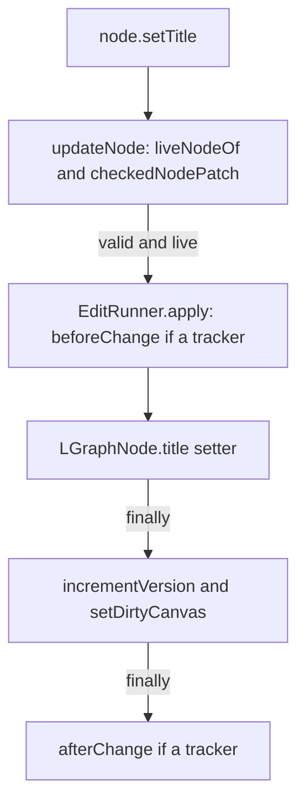

# ADR-EXTENSIONS-NODE-API-0073: A functional edit core for the V4 node API

Date: 2026-11-12

## Status

Proposed

## Context

[ADR-EXTENSIONS-NODE-API-0070](EXTENSIONS-NODE-API-0070-versioned-node-api-with-document-scoped-handles.md)
defines document-scoped handles. Packs also change the document through them:
they retitle, recolor, move and resize nodes, set properties, add and remove
nodes, and wire and reshape slots. The stored V2 packs make these calls as
methods on the handles (`node.setTitle(...)`, `slot.modify(...)`), and 121 of
them make at least one, so the methods have to keep working.

The [V2 review](https://github.com/Comfy-Org/ComfyUI_frontend/pull/16790#discussion_r3927590595)
asked for serializable commands and a single owner for graph writes. Today the
host has layout operations (`LayoutOperation`) for positions and sizes, graph
intents (`graphIntents.ts`) for adding and removing nodes and links and for a
node's title, mode, collapsed and pinned fields, which the agent's
`docOpMinter.ts` mints into shared-document operations when a shared document
is bound, and snapshot-based undo through the change tracker. Colors, shapes,
properties, widget saving and slot fields have neither command form. V4 keeps
the handle methods packs use and gives their writes one path to the existing
host owners. The command interface is
[#16852](https://github.com/Comfy-Org/ComfyUI_frontend/issues/16852).

## Decision

Use handle methods to edit. For example, batch a set of title changes so the
open workflow records them as one undo step:

```js
import { comfy } from '/comfy/api/v4.js'

comfy.graph.batch(() => {
  comfy.graph.node('12')?.setTitle('Prepare input')
  comfy.graph.node('24')?.setTitle('Save output')
})
```

A batch groups local history. It does not roll back the edits made before a
throw, and in a shared session other participants receive only what the host
announces (decision 27).

### Validation, resolution and commit

1. Every edit runs through an edit runner (`edit/editRunner.ts`) as one undo
   step. Node, slot, link and group edits go through the edit core,
   `edit/edits.ts`, on the core's runner. Widget edits
   (`widgets/widgetEdits.ts`, ADR-EXTENSIONS-NODE-API-0072 decision 5) and
   `workflow.setExtra` (ADR-EXTENSIONS-NODE-API-0075) run on a second runner
   over the same history; neither is a core function. The runner keeps no
   state of its own (nesting is the change tracker's), so two runners make
   the same steps as one would.
   - Packs reach the core through handle methods (`node.setTitle`,
     `slot.modify`, `inputs.reorder`, `graph.add`, `graph.batch`,
     `group.setBounds`). Each core function takes handles and plain data. A
     node edit names its node by graph id and node id, which a command could
     carry; a slot handle's id is a number this session gives the slot
     object, and `batch` takes a function, so those are not yet command data.
   - The core is not published. It is published later as a patch
     (ADR-EXTENSIONS-NODE-API-0070 decision 2), once #16852 gives it command
     data: published now, its unfinished shape would be permanent
     (ADR-EXTENSIONS-NODE-API-0070 decision 4), and it would be a second
     spelling of every handle method, which no stored pack calls.
     `createComfyApi` hands the core back beside `comfy` and `host` for the
     core's own contract tests. The core keeps the checks of a published door
     (that a value is a handle of this API, that two slots share a graph or a
     node), so publishing it adds no check.
2. Each edit checks, resolves, then commits:
   1. It checks every argument a pack passed and throws a `TypeError` from
      `invalidArgument` for the first it cannot use, even when the entity is
      gone. An object argument is copied once, each field read once, before
      it is checked, and numbers must be finite.
   2. It resolves each handle in the handle's own graph and document,
      through the seams the handle factories expose (`NodeHandles.locator`).
      A value that is not a handle this API made throws. A handle whose
      entity is gone, or whose document is no longer open, makes the edit
      return `false` (or `undefined` where it returns a value), and nothing
      changes. A check that needs the entity (a slot name the node already
      has, a subgraph node, a Note's widget saving) runs only after it is
      found.
   3. It applies the change through the host's own owner of that state (see
      the mutation table) inside `EditRunner.apply`, which opens a change
      tracker transaction.
   4. It advances the version of the graph it changed and marks it for
      redraw, in a `finally`.

   A refusal leaves the document as it was. A host hook (`onResize`,
   `onConnectionsChange`, `onInputAdded`) that throws during step 3 stops
   the edit part way: what was applied stays, step 4 still runs, the
   transaction closes, and the error reaches the caller.

3. The transaction is the change tracker's `beforeChange()` and
   `afterChange()`, supplied as the optional `history` service
   (`useWorkflowStore().activeWorkflow?.changeTracker`). Nested transactions
   count, so the tracker captures once, when the outermost closes, and only
   if the serialized workflow changed. With no open workflow the edit
   applies with no undo step. After an undo or redo, until the user's next
   action, the next undo or redo, or one second after the restore, whichever
   comes first, the tracker takes a change into the restored state instead of
   recording it (ADR-EXTENSIONS-NODE-API-0075 decision 13), so an edit a pack
   makes in reaction to the restore is no undo step and keeps redo. The capture serializes, clones and compares
   the whole document, so a loop of separate edits is quadratic. Measured in
   the unit environment (`happy-dom`, 20 title edits): 6.5, 12, 27 and 52 ms
   per separate edit at 250, 500, 1,000 and 2,000 nodes, against 4.9, 12, 26
   and 72 ms for all 20 inside one `batch`; the API's own work is 0.008 ms
   per edit, so the cost is the host's capture, as for an edit the editor
   makes. The `batch` JSDoc tells a pack to loop inside one batch.
4. Each handle method is one call into the core: `node.setTitle(title)` is
   `updateNode(node, { title })`, and a refusal names `setTitle`. Handle
   methods hold no edit logic and own no second write path.
5. Edits are not replayable commands of their own. They call the host
   methods the editor's own UI calls, so an edit raises the graph intent or
   layout operation that method raises, and no other (decision 27).

`updateNode` reaches the runner only after its checks. The diagram shows
where history begins and ends for `node.setTitle`:



### Node changes and batching

6. `updateNode(node, patch)` checks the whole patch and leaves omitted fields
   alone. Fields apply in a fixed order (title, mode, collapsed, colors,
   shape, properties, serializeWidgets, position, size, sizeConstraints,
   resizable), whatever the order of the patch's keys, so `size` and
   `sizeConstraints` together fit the new size to the constraints.
   - `mode` is `'always'`, `'never'` or `'bypass'`. LiteGraph's `ON_EVENT`
     and `ON_TRIGGER` have no name: ComfyUI gives them no meaning (the prompt
     builder skips only `NEVER` and `BYPASS`), no stored pack uses them, and
     they read as `undefined`.
   - `color` and `bgColor` take a string, or `undefined` or `null` to restore
     the default; `shape` takes `'default'` to restore it. `collapsed`
     collapses or expands a node even when it is pinned.
   - `properties` sets each named property through `node.setProperty`, so
     the node's `onPropertyChanged` and property widgets see it. Each value
     is stored as a copy the workflow saves unchanged
     (ADR-EXTENSIONS-NODE-API-0070 decision 13), and a name must be a
     non-empty string that is not an `Object.prototype` member. `undefined`
     deletes the property, as `setProperty(name, undefined)` cleared it in V2
     (5 stored calls): the edit goes through `setProperty`, then removes the
     name, and deleting an absent property changes nothing and answers
     `true`. If the node or a pack's hook keeps a value (a refusal, or
     `setValue`), `updateNode` answers `false` and the rest of the patch
     stays applied.
   - `position` and `size` need finite numbers, and a size cannot be
     negative. `size` goes through `node.setSize`, so `onResize` runs.
7. `sizeConstraints` resizes the node into the limits once: width and height
   are clamped between their minimum and maximum, and `autoHeight` first
   sets the height to `node.computeSize()`'s. The fitted size is requested
   once, through `setSize`; the node's `onResize` runs inside that call and
   may set another size, which stands, so the size when the call returns can
   be outside the limits. A later resize, by the user or a pack, is not held
   to them either. Each limit must be finite and zero or more,
   and a minimum may not exceed its maximum. Holding a node to limits needs a
   host owner both renderers honor (see "Known gaps in the host").
8. `resizable` sets the node's flag to the pack's choice unless the node is
   pinned, as the host keeps a pinned node unresizable. The API keeps no
   copy of the choice: LiteGraph's `pin()` sets the flag to `!pinned`, so
   pinning and unpinning a node makes it resizable whatever the pack chose,
   and the API keeps that host behavior
   ([#23731](https://github.com/Comfy-Org/ComfyUI_frontend/issues/23731)).
   The flag is not saved, so a node undo or a load rebuilds has the type's
   own. There is no `isResizable()`: no stored pack reads it back.
9. `removeNode(node)` removes the node through `LGraph.remove`, which removes
   its links. It returns `false` if the node is gone or the host keeps it
   (`ignore_remove`).
10. `batch(edits)` runs a pack's function now, in one transaction, and
    returns its result. An `async` function is refused before it runs. A
    plain function that returns a promise is not refused: the edits made
    before it returns are one step, and later edits are separate steps. If
    the function throws, its edits stay, the transaction closes, and the
    error is rethrown. There is no rollback, because main has no inverse for
    most edits.

### Visible graph and own-graph handles

11. `addNode(graph, type, init?)` takes a graph scope handle, so the core can
    add to a subgraph that is not on screen. It makes the node with
    `LiteGraph.createNode`, with its title and position, before `LGraph.add`,
    so the graph's `onNodeAdded`, the layout store and `node:added` see it
    where it will stay. The title goes through `createNode`'s options, as
    `createNode` replaces a falsy title argument with the type's, so a title
    given as `''` is kept. The type is checked to be registered first; then
    making the node and adding it run inside the edit's one transaction, so
    an edit the node's creation callback (`onNodeCreated`) makes through the
    API is part of the same undo step. It returns the new node's handle, or `undefined`,
    adding nothing, if the graph is gone or the type is not registered: a
    pack's backend nodes may not be installed, so a missing type is a state
    of the app, not a mistake in the pack.
12. `comfy.graph.add(type, init?)` is `addNode` on the graph on screen at the
    call; with no graph on screen it still checks its arguments and returns
    `undefined`. `comfy.graph.batch` is the core's `batch`: one transaction
    of the open document, whatever graph its edits touch, off-screen ones
    included.
    - Every `comfy.graph` member that reads or acts on a graph (`id`, `node`,
      `nodes`, `add`, `links`, `groups`) asks the canvas again each time, so
      two calls a moment apart reach different graphs if the user opened or
      left a subgraph in between. A handle it gives does not follow the user:
      a node, slot or group handle edits its entity in the entity's own
      graph, on screen or not. A pack that needs one graph for several
      graph-level calls compares `comfy.graph.id`, or reaches a particular
      graph through `root()` and `subgraphs()`.
    - `GraphScopeHandle` has no `add`, `batch` or `version`: no stored pack
      adds to an off-screen graph or batches per graph, and the two stored
      packs that read `version` want the document's count, which
      `comfy.graph.version` gives. Adding any of them is a patch.
13. `comfy.graph.links()` lists the links of the graph on screen as frozen
    `LinkInfo` records sorted by link id. `comfy.graph.version` counts the
    changes to the open document:
    - Each reading compares the document's change marks with the last
      reading's: the version counters (`LGraph._version`) of its root graph
      and of each subgraph definition, with their ids, and the number of
      rebuilds the API is told of. If any mark differs, the reading is one
      more than the last; otherwise it is the same. So it reads the same
      whichever graph is on screen, an edit through a handle to an off-screen
      graph changes it, and it never goes back to a value it has left.
    - Every edit a handle applies advances its graph's counter, including
      when the host declines after the runner has started; a refusal, an
      unlinked `disconnect` or a call on a gone entity, which exit before
      `apply`, does not. The host advances a counter for some of its own
      changes and not others: nodes and links added or removed, a node
      collapsed or pinned, and a widget value committed through
      `BaseWidget.setValue` count; a move and a color do not
      (`graphEdits.test.ts`).
    - An undo, a redo or a load rebuilds the graphs and restarts their
      counters; the rebuild count (a document beginning or ending, a restore
      finishing) and the root id a clear replaces are among the marks, so an
      undo and the redo after it read differently, as the two stored readers,
      which poll or fingerprint it, need. A subgraph definition released
      with its last node, or a clear the API is not told of, changes the
      marks too, so the reading after it is new.
    - An equal reading says that nothing the marks count changed; a move or
      a color is not counted. The JSDoc names no host change that does or
      does not count, because which of them count is the host's to change,
      and a host fix must not change what v4 is documented to do
      (ADR-EXTENSIONS-NODE-API-0070 decision 1).

### Slot identity, topology and links

14. A slot handle names one slot object of one node. The host has no stable
    slot identity: a link records its slots by index, Vue nodes and the
    layout store key a slot by node, side and index, and names may repeat.
    The handle follows its slot through renames and index shifts and reports
    `isDeleted` once the slot or its node is removed or its document is no
    longer open. Undo and redo rebuild every slot as a new object, so a slot
    handle does not survive them, unlike a node handle;
    `afterHistoryRestore()` retires the handles whose slot is no longer on
    its node, and a pack reads `node.inputs` or `node.outputs` again. Slot
    handles use the same per-document caches as node handles, so
    `sameEntity` works on them. A slot's `id` is a string the API gives the
    slot object in a `WeakMap`, so nothing is written to the slot or the
    workflow. A command interface needs persistent slot identity.
15. `node.inputs` and `node.outputs` are collections over the live slots. A
    `SlotRef` is a slot id, else a slot name, else a plain `{ index }` with a
    whole index of zero or more, read once through `checkedFields`. A bare
    number, a slot handle and a class instance are refused, so a position is
    visible at the call site. A name two slots share finds nothing in
    `byName`, and is refused where a pack asked for one slot (`remove`,
    `connectTo`, `moveLinksTo`).
16. `updateSlot(slot, patch)` changes a slot's name, label, localized name,
    type, colors, shape, position and direction, and an input's `widget`.
    - The canvas renderer draws the colors and the shape; under Vue nodes the
      dot keeps its type's color and draws `'directional'` as a circle
      ([#24161](https://github.com/Comfy-Org/ComfyUI_frontend/issues/24161)),
      while `direction` shapes the links in both renderers. The slot visuals
      stay in 4.0: rgthree-comfy, comfyui-kjnodes, cg-use-everywhere and
      comfyui-mxtoolkit set them, and the canvas renderer is the default.
    - A name another slot on the same side has is refused, so slots stay
      addressable by name. The empty name is allowed on any number of slots,
      as V2 allowed it and the host's own `Reroute` uses it; `byName('')`
      finds a slot only when it is the only one so named.
    - A `widget` the node does not have, or one another input is already the
      socket of, is refused; `widget: null` (or `undefined`, when the patch
      names it) makes the input a plain socket again and drops the position
      the host's layout wrote on it from the widget's row, which the canvas
      would otherwise draw and the workflow save as the input's own; a
      position in the same patch is then applied, and an input that had no
      widget keeps its position. A `position` for an
      input that is, or the same patch makes, a widget's socket is refused:
      the host places such an input by its widget and does not save its
      position.
    - A type that is empty or an `Object.prototype` member, alone or in a
      list, is refused for every slot edit, as `defs.define` refuses it: the
      host's slot-type registry would add the slot and then fail. A list is
      stored joined by commas, as the host compares it. An output's new type
      goes through `setOutputDataType`, which retypes its links; an input's
      link is kept.
    - `null` or `undefined` clears a field that has a default (label,
      localized name, colors, shape, position, direction). Decisions 24 and
      26 say what a load gives back and refuse a subgraph node's slots.
17. `addInput` and `addOutput` append through `node.addInput` and
    `node.addOutput` with the same name rule. `removeSlot` removes one through
    `removeInput` or `removeOutput`, which drop its links and shift the later
    slots' links, floating links (links detached onto a reroute) included:
    `removeInput` now removes the floating links into the input it removes,
    once the inputs are replaced, instead of leaving them at that index for
    the input that moves up (a core change; #24205 does not cover it).
18. `reorderSlots(node, side, names)` takes each slot's name once and moves
    the slots with their links in one step. Inputs go through the host's
    `captureInputLayout` and `replaceNodeInputs`; outputs through one
    `updateEndpoints` call on the link store, which validates every
    re-pointed link before it moves any, then the output list. Link ids do
    not change. Floating links (links detached onto a reroute) of reordered
    outputs move with them; floating links of reordered inputs keep their
    slot index, as `replaceNodeInputs` leaves them, on whichever input moved
    there ([#23466](https://github.com/Comfy-Org/ComfyUI_frontend/issues/23466);
    the host fix is PR #24205, see "Known gaps in the host").
    If the store refuses, nothing moves and the call answers `false`. An
    order the slots already have answers `true` with no step and no version
    change.
19. `connect(output, input)` links two slots of one graph through
    `LGraphNode.connect`, so the host's type check and the nodes' connection
    hooks apply; it gives the link, or `undefined` if the host refused.
    `disconnect(slot, target?)` removes an input's link, or an output's links
    (only those to `target` if given), through `disconnectInput` and
    `disconnectOutput`; a slot with no link answers `false` without a step.
    The host's `disconnectOutput` given a target removes its first link to
    that node only, so for a target the API selects the output's links to it
    when called and removes each through the target's `disconnectInput`, in
    the same step: an output that feeds two inputs of the target loses both
    links. A selected link a connection callback of an earlier removal took
    away or moved is left alone, and a link a callback made is not removed.
    `moveLinks(from, to)` re-points every link of one output to another output
    of the same node through `updateEndpoints`, keeping the link ids, and
    does not check types again, so a pack can move links before retyping the
    output.
20. `output.connectTo(nodeId, input)` and `output.disconnect(nodeId)` look the
    id up in the output's own graph, never the graph on screen. A node or
    slot that is not there answers `undefined` or `false`; a node id that is
    not a string throws.

### Group reads and node registrations

21. `comfy.graph.groups()` and a graph scope's `groups()` give a handle for
    each group, in draw order. A group handle names a group by its id in its
    graph and follows the rules of a node handle: it survives undo and redo
    and is retired when another document loads or a restore finds the group
    gone with its id free to be given again (ADR-EXTENSIONS-NODE-API-0070
    decision 10). It reads the group's title, color and bounds. `nodes()`
    gives the nodes whose center, title bar included, is inside the group
    now, measured as `getBounds` measures a node; the group's own cached
    list, which `recomputeInsideNodes` rewrites, is neither read nor
    changed. The one group edit is its bounds (decision 28).
22. `isSerializingWidgets()` and `snapshot()` read the live node and return
    `undefined` once it is gone. The snapshot is a frozen copy of the node's
    identity, title, mode, flags, colors, shape, position and size; a shape
    with no name here reads as `'default'`, and a mode with no name as
    `undefined`, in `getMode()` too. The names are a `Map`, so a mode stored
    as `'toString'` or `'__proto__'` finds no inherited member.
23. `addBadge(badge)` is a registration, not an edit: badges are not saved
    and make no undo step. It pushes an `LGraphBadge` onto `node.badges` and
    returns a disposer that removes that entry only and is safe to call
    twice. An object badge is read once. A function badge is one
    `LGraphBadge` whose text, colors and click handler the function sets each
    time the canvas draws it, so a click finds the badge drawn; a function
    that throws or returns something that is not a badge is reported once
    and hides the badge from then on. A click handler runs through the
    listener isolation. Rebuilding the node removes the badge, and a gone
    node gets a disposer that does nothing. Under Vue nodes a badge added or
    removed after the node is first drawn shows or goes only when the
    node's badges are next recomputed
    ([#24163](https://github.com/Comfy-Org/ComfyUI_frontend/issues/24163)).

### Persistence limits

An undo or redo is a load of a saved state (ADR-EXTENSIONS-NODE-API-0070
decision 10). The API is not stricter than the host it wraps: an edit the
legacy API and the editor apply is applied, as one undo step, even where the
next load gives back part of what it changed. Refusing such edits threw in
the stored conversions of at least nine packs, about 45 call sites. What a
load gives back is stated in the contract instead, and an edit is refused
only where it makes a later load erase content the pack does not own, or
leaves the graph feeding execution the wrong data.

24. Slots a node's type makes. A load builds each node with its type's
    constructor and merges the saved node into it.
    - A backend type (`registerNodeDef` in `litegraphService.ts`) rebuilds
      each input its constructor made, matched by name, with that input's
      `name`, `type`, `shape`, `localized_name` and `widget`, in the
      constructor's order, then any other saved input; each declared output,
      matched by position, takes back the same fields. So after a load a
      renamed declared input is the declared input plus a second input under
      the new name, a retyped, reshaped or retranslated declared slot has the
      type's value again, a removed or reordered declared slot is back in
      place, and a declared input that stopped being a widget's socket is
      one again.
    - Any other type (a `defs.define` type, one a legacy extension registers)
      gets the slots its constructor makes with the saved slots merged in by
      position, and no list is shortened: a slot removed from the
      constructor's slots comes back after the remaining ones, so names can
      repeat.
    - A label, colors, a position on an input that is not a widget's socket
      and a direction are saved and kept, and so is every edit of a slot a
      pack added (a backend type keeps added inputs in their saved order).

    `updateSlot`, `removeSlot` and `reorderSlots` still apply these edits,
    return `true` and make an undo step; the `SlotPatch` and `SlotCollection`
    JSDoc state what a load gives back, and `loadLimits.test.ts` records it
    and fails when the host starts keeping such an edit. A pack that needs
    one to last applies it again where the node is created or configured,
    except a rename of a declared input: after a load the node has the
    declared input back, unlinked, beside the renamed one that holds the
    saved link, so the same rename is refused as a name the node already
    has. Such a pack reconciles the two slots itself (links the renamed
    input's source to the declared input and removes the renamed one), or
    shows another name with `label`, which a load keeps.

25. Widget saving. A backend type, a Note, a MarkdownNote and a PrimitiveNode
    turn `serialize_widgets` on in their constructors, and the flag is not
    saved, so after `false` the next load turns saving on again with no
    widget values to restore. `serializeWidgets: false` is applied as the
    host applies it, except on a node whose widgets hold only what the user
    typed (a note's text, a primitive's value), where it is refused: no pack
    owns such a node, so a pack would erase the user's content at the next
    undo, redo or reload. The node's class says so with the static
    `widgetsHoldUserContent`, a field of LiteGraph's node constructor type
    that the host's `Note`, `MarkdownNote` and `PrimitiveNode` classes set,
    so the rule has one owner and a type that later holds user content (a
    pack's own note) opts in by setting it. The refusal names the property,
    not the types. Two other host lists name the notes (the change tracker's
    non-executable types, app mode's hidden types); they answer other
    questions and stay as they are. None of the six stored V2 calls that
    turn widget saving off targets those three types.
26. A subgraph node's slots are its subgraph's inputs and outputs, which
    execution maps by position; an edit to the node's own list would feed a
    source to another input. So every slot edit on a subgraph node is
    refused, except an input reorder, which goes through the host's
    `reorderSubgraphInputs` and reorders the subgraph's inputs and the
    node's together. That reorder requires exactly one node in the document
    that places the subgraph, because the host leaves any other placement
    in the old order with its links feeding other inputs; a subgraph placed
    once inside a subgraph that is itself placed several times is one node.
    Floating input links keep their index, as in decision 18 (#23466, PR
    #24205). A pack edits
    the subgraph's inputs and outputs in the subgraph.

### Local edits and shared delivery

27. Each edit announces what the host method it calls announces: `title`,
    `mode` and `collapsed` a `set_node_field` intent, `addNode` an
    `add_node`, `removeNode` a `remove_node`, `connect` and `disconnect` a
    `connect` or `disconnect`, `position` and `size` a layout operation, and
    a group's `bounds` two `setGroupBounds` layout operations. The other node
    fields, slot fields, `addInput`, `addOutput` and the input reorder
    announce nothing, as the same edits by the editor's own code do not.
    `moveLinks` and the output reorder re-point links in the link store,
    which raises no intent, and no intent kind describes them.
    - In a session bound to a shared document, those slot and link edits
      would reach no other participant, and the documents would drift apart
      until the next full load: the shared document holds each node's slots
      and each link's ends, so a later operation the others receive would
      name another slot. So on such a document `updateSlot`, `addInput`,
      `addOutput`, `removeSlot`, `reorderSlots` and `moveLinks` change
      nothing and make no step: they answer `false`, or `undefined` where
      they give a handle or links. `updateSlot` is refused whatever its patch
      names, because no slot field raises an intent. A node's own color,
      shape or property is not refused: it is no slot or link, so it leaves
      what later operations name as it is, though other participants do not
      receive it.
    - A document is bound when the host's marker says so:
      `isRootGraphDocBound` in `docBoundGraphs.ts`, which the agent's
      document minter answers for the root graph whose edits it sends and
      which LiteGraph already reads to mint node ids. The marker names a root
      graph, so an edit in any graph of that document, a subgraph definition
      included, is refused; an edit in another document, or with no shared
      session, applies as before.
    - The refusal is a value, not a throw: whether a document is shared is a
      state of the app that a pack cannot prevent and has no read for, as a
      type that is not installed is (decision 11). It comes after every
      argument and entity check, so a mistake in a pack throws whether or
      not the document is shared, and an order the slots already have still
      answers `true` with no step.
    - Re-pointing by disconnecting and connecting would give every moved link
      a new id, against decision 19, and announcing from the API would
      describe changes that did not happen. An intent kind for endpoint
      changes and for slot fields and structure is a core change
      ([#23382](https://github.com/Comfy-Org/ComfyUI_frontend/issues/23382)).
      Once core announces them, the refusal is removed and these calls are
      correct with no other change. A local undo step does not prove
      synchronization.

### Group bounds

28. `updateGroup(group, patch)` takes one field, `bounds`: the group's
    rectangle in graph space, title bar included, as `getBounds` reads it.
    `group.setBounds(bounds)` is `updateGroup(group, { bounds })`, and a
    refusal names `setBounds`. Two stored packs call it: comfyui-touch-resize
    on each pointer move of a group's corner handle, and
    comfyui-workflow-prettier after it lays out nodes.
    - `x` and `y` must be finite, `width` and `height` finite and zero or
      more, each read once; any other field is refused.
    - The edit assigns the group's `pos` and then `size` setters, each of
      which writes a `setGroupBounds` layout operation, the same path as the
      editor's group-resize drag. Groups are drawn by the canvas under both
      renderers, so the edit is the same under Vue nodes.
    - A width or height below `LGraphGroup.minWidth` or `minHeight` is raised
      to it by the setter, as the editor's resize is, and the call still
      returns `true`.
    - The nodes inside do not move, and the group's cached list of children
      is not recomputed, as in the editor's resize; comfyui-workflow-prettier
      moves the nodes itself first.
    - A pinned group is moved and resized: the pin stops the pointer, not the
      setters, as `updateNode` moves a pinned node.
    - It targets the group's own graph, on screen or not, and returns `false`
      without a step for a group that is gone or whose document is no longer
      open.

## The mutation table

"Step" is what one call does to undo history when the host has an open
workflow. Every edit advances its graph's version. "Refused" is what an
unusable argument leaves: always the document unchanged, with a `TypeError`.
"Gone" is what a call does with a handle whose entity is deleted or whose
document is no longer open.

| Edit                                     | Host owner it goes through                                                                                                                                              | Step                                                                   | Gone                                   |
| ---------------------------------------- | ----------------------------------------------------------------------------------------------------------------------------------------------------------------------- | ---------------------------------------------------------------------- | -------------------------------------- |
| `updateNode` `title`                     | `LGraphNode.title` setter: node state store and a `set_node_field` graph intent                                                                                         | One step                                                               | `false`, nothing changed               |
| `updateNode` `mode`                      | `LGraphNode.mode` setter: node state store and a `set_node_field` graph intent                                                                                          | One step                                                               | `false`                                |
| `updateNode` `collapsed`                 | `LGraphNode.collapse(true)`: flag and a `set_node_field` graph intent                                                                                                   | One step                                                               | `false`                                |
| `updateNode` `color`, `bgColor`, `shape` | `LGraphNode` setters: node state store                                                                                                                                  | One step                                                               | `false`                                |
| `updateNode` `properties`                | `LGraphNode.setProperty` per name: `onPropertyChanged`, property widgets; `undefined` then deletes the name                                                             | One step                                                               | `false`                                |
| `updateNode` `serializeWidgets`          | `LGraphNode.serialize_widgets`; `false` refused on a node whose class sets `widgetsHoldUserContent` (decision 25)                                                       | One step; a load gives the type's own value                            | `false`                                |
| `updateNode` `position`                  | `LGraphNode.pos` setter: a `moveNode` layout operation                                                                                                                  | One step                                                               | `false`                                |
| `updateNode` `size`, `sizeConstraints`   | `LGraphNode.setSize`: a `resizeNode` layout operation, then `onResize`                                                                                                  | One step                                                               | `false`                                |
| `updateNode` `resizable`                 | `LGraphNode.resizable` (node state store); the host's unpin sets it to `true`                                                                                           | No step: not saved                                                     | `false`                                |
| `updateNode` with several fields         | All of the above in one transaction                                                                                                                                     | One step for the patch                                                 | `false`                                |
| `removeNode`                             | `LGraph.remove`: links, stores, selection, `node:removed`, `remove_node` graph intent                                                                                   | One step                                                               | `false`                                |
| `addNode`                                | `LiteGraph.createNode`, then `LGraph.add`: id, stores, layout, `onNodeAdded`, `add_node` graph intent                                                                   | One step                                                               | `undefined`, nothing added             |
| `updateSlot`                             | The slot's own fields; `setOutputDataType` for an output's type; refused on a subgraph node (decision 26)                                                               | One step                                                               | `false`                                |
| `addInput`, `addOutput`                  | `LGraphNode.addInput`, `addOutput`; refused on a subgraph node                                                                                                          | One step                                                               | `undefined`, nothing added             |
| `removeSlot`                             | `LGraphNode.removeInput`, `removeOutput`; refused on a subgraph node                                                                                                    | One step                                                               | `false`                                |
| `reorderSlots`                           | Inputs: `replaceNodeInputs`, or `reorderSubgraphInputs` on a subgraph node placed once; outputs: `updateEndpoints`, then the list; refused on a subgraph node's outputs | One step; `false` if the link store refuses, slots and links unchanged | `false`                                |
| `connect`                                | `LGraphNode.connect`: the type check, `onConnectInput`, `onConnectionsChange`, a `connect` graph intent                                                                 | One step; `undefined` if the host refuses                              | `undefined`                            |
| `disconnect`                             | `LGraphNode.disconnectInput`, `disconnectOutput`: `onConnectionsChange`, a `disconnect` graph intent                                                                    | One step; `false` and no step for a slot with no link                  | `false`                                |
| `moveLinks`                              | The link store's `updateEndpoints`, all links validated before any moves                                                                                                | One step; `undefined` if the store refuses, links unchanged            | `undefined`                            |
| `batch`                                  | The change tracker's transaction around the pack's function                                                                                                             | One step for all edits inside                                          | Each edit inside answers for itself    |
| `updateGroup` `bounds`                   | `LGraphGroup.pos`, then `size`: two `setGroupBounds` layout operations; the nodes inside stay (decision 28)                                                             | One step                                                               | `false`                                |
| `addBadge` (registration)                | `LGraphNode.badges`                                                                                                                                                     | No step: not saved                                                     | No badge, a disposer that does nothing |

In a document bound to a shared document, `updateSlot`, `addInput`,
`addOutput`, `removeSlot`, `reorderSlots` and `moveLinks` answer as in the
"Gone" column and make no step (decision 27).

A step is captured only if the serialized graph changed, so an edit that
changes nothing a workflow saves (a title set to itself) adds no entry. An
edit the host declines once it is applied (a link `connect` will not make, an
update the link store rejects) still advances the graph's version, and the
tracker records nothing.

## What is left out

Counts are stored packs and call sites from the member census of the earlier
contract. A member no stored pack calls is cut.

| Member                                                                                                                                                      |               Packs, sites | Why                                                                                                                                                                                                                     |
| ----------------------------------------------------------------------------------------------------------------------------------------------------------- | -------------------------: | ----------------------------------------------------------------------------------------------------------------------------------------------------------------------------------------------------------------------- |
| `GraphHandle.remove(id)`                                                                                                                                    |                       0, 0 | `node.remove()` covers it                                                                                                                                                                                               |
| `NodeHandle.setPinned`, `getShape`, `getSizeConstraints`, `isResizable`                                                                                     |                       0, 0 | No use; `snapshot()` reads the shape                                                                                                                                                                                    |
| `GroupHandle.setTitle`, `setColor`                                                                                                                          |                       0, 0 | No use, so `bounds` is the only field `updateGroup` takes                                                                                                                                                               |
| `SlotCollection.get`, `ids`; `SlotOptions.localizedName`, `position`, `direction`                                                                           |                       0, 0 | No use; `byId`, `at` and `byName` remain                                                                                                                                                                                |
| `SlotSnapshot.*` fields read on their own                                                                                                                   |                       0, 0 | `snapshot()` is used (3 packs) and returns them all                                                                                                                                                                     |
| `GraphHandle.select`, `selection`, `centerOn`, `setZoom`, `panBy`, `pointerPosition`; `GroupHandle.centerOn`; `NodeHandle.getScreenRect`, `getSlotPosition` | 12, 9, 6, 2, 1, 4; 3; 4, 1 | View state, not document edits: no undo step, no command. ADR-EXTENSIONS-NODE-API-0075 adds them with the viewport and selection events                                                                                 |
| `NodeHandle.getOutputImages`, `getDisplayedImageIndex`                                                                                                      |                       8, 4 | Execution output, not graph state                                                                                                                                                                                       |
| `GraphHandle.resolvedSupplies`, `GraphScopeHandle.resolvedSupplies`, `InputSlotHandle.resolvedSource`                                                       |                    1, 1, 2 | Frontend execution's resolvers own them; ADR-EXTENSIONS-NODE-API-0076 adds the two `resolvedSupplies`                                                                                                                   |
| `GraphHandle.replace`, `duplicate`                                                                                                                          |                       3, 1 | The host has no owner for rebuilding a node as another type with its state and links (`useNodeReplacement` serves missing backend types and its planning is private); building one here would be a second mutation path |
| `InputSlotHandle.widgetConfig`, `mergeWidgetConfig`; `InputSlotPatch.widgetConfig`; `SlotOptions.widgetConfig`                                              |                 3, 2; 5; 4 | They rebuild a connected Primitive node's widget from an input spec, which is the widget owner's work                                                                                                                   |
| `NodeHandle.widgets`                                                                                                                                        |                        101 | The widget collection is its own feature, ADR-EXTENSIONS-NODE-API-0072                                                                                                                                                  |

Nothing in this feature existed only for the sandbox the earlier API was
built for. Its closed proxies are replaced by frozen objects, as in
ADR-EXTENSIONS-NODE-API-0070.

## Known gaps in the host

- **A load gives back slots a type makes** (decision 24). Ticket draft:
  _Title:_ "A load undoes edits to the slots a node's type makes".
  _Reproduction:_ rename `KSampler`'s `model` input
  (`node.inputs[0].name = 'mdl'`), save and load: the node has `model`
  unlinked and an extra `mdl` input with the link. _Direction:_ let the saved
  slot list be the node's slot list (shorten to the saved length, keep a
  saved slot's name, type, shape and order), and match a backend type's
  declared slots to it by a slot id rather than by name or position.
- **Reordering one instance of a subgraph** (decision 26). Ticket draft:
  _Title:_ "Reordering a subgraph's inputs from one instance leaves its other
  instances in the old order". _Direction:_ reorder every instance's inputs
  in the same call. Until then `reorderSlots` refuses the reorder while the
  subgraph is placed more than once.
- **Slot identity across undo** (decision 14). Ticket draft: _Title:_ "Give
  node slots an id that survives serialization". _Direction:_ a slot id kept
  in the saved workflow, as links keep theirs.
- **Size limits after the call** (decision 7). LiteGraph's resize uses
  `computeSize` and `constructor.min_height`, and the Vue renderer reads the
  element's CSS `min-width` and measures content. Ticket draft: _Title:_
  "Give nodes a declared minimum and maximum size that both renderers
  honor". _Direction:_ a min/max size in the node's layout state, read by
  `useNodeResize` and by LiteGraph's resize.
- **Floating links on an input reorder** (decision 18).
  `replaceNodeInputs` does not move floating links, so after an input
  reorder a floating link names whichever input moved to its index. This is
  a wrong result, not an intended one, and the API does not work around it.
  Filed as
  [#23466](https://github.com/Comfy-Org/ComfyUI_frontend/issues/23466); the
  fix is open as
  [PR #24205](https://github.com/Comfy-Org/ComfyUI_frontend/pull/24205),
  which makes `replaceNodeInputs` move each floating link to its input's
  new slot. The V4 tests that cover it (`editEdges`, `editContracts`,
  `loadLimits`) assert the result #24205 gives and are marked `it.fails`
  with the PR in their titles, so they are switched to plain tests once it
  lands.
- **No intent for re-pointed links or slot edits** (decision 27,
  [#23382](https://github.com/Comfy-Org/ComfyUI_frontend/issues/23382)). The
  API refuses these edits on a shared document and applies them everywhere
  else; once core announces them, the refusal is removed.
- **Vue nodes** (Nodes 2.0 team). Late badges
  ([#24163](https://github.com/Comfy-Org/ComfyUI_frontend/issues/24163)):
  `usePartitionedBadges` computes from `node.badges`, a plain array no
  reactive state depends on, and the API cannot make it reactive without
  changing a host object's field. Slot visuals
  ([#24161](https://github.com/Comfy-Org/ComfyUI_frontend/issues/24161)):
  `SlotConnectionDot.vue` colors a dot by its type only and draws
  `RenderShape.ARROW` as a circle. Double click
  ([#24162](https://github.com/Comfy-Org/ComfyUI_frontend/issues/24162),
  ADR-EXTENSIONS-NODE-API-0071 decision 28).
- **Unpinning makes a node resizable** (decision 8,
  [#23731](https://github.com/Comfy-Org/ComfyUI_frontend/issues/23731)).
  `updateNode`'s `resizable: false` and a definition's
  `presentation.resizable: false` last until the user unpins the node.
  _Direction:_ leave `resizable` alone in `pin()` and `configure()`, and have
  the resize paths check `pinned` as well; `chooseResizable` in
  `edit/nodeSizing.ts` then sets the flag to the choice alone.
- **A resizable choice after undo** (decision 8). Undo rebuilds nodes from
  the saved workflow, which does not hold the flag. Saving it would change
  the workflow format.

## Alternatives considered

- **Handle methods as the place edits happen**, as in V2. Handles would be a
  second mutation authority; with every method a call into one core there is
  one place to audit and, later, to route to commands.
- **Read-only handles, with packs moved to functional calls.** A checker
  could prove only 40% of the stored mutator calls are handle edits, so the
  conversion cannot be done by a script.
- **One function per field** (`setTitle(node, title)`). A patch per kind of
  entity is the smaller surface, carries several fields as one step, and is
  already the shape of a command's data.
- **Publishing the core as `comfy.edit`.** None of its 13 functions has a
  stored use (130 converted packs, 0 sites); each is a second spelling of a
  handle method. Node identity can be graph id plus node id, but the slot id
  and the `batch` callback are not durable command data, and a bare node id
  without graph and document scope is not enough.
- **Rolling back a failed batch.** Main has no inverse for most edits, and
  restoring the tracker's last snapshot would also discard edits the user
  made before the batch.
- **Holding size constraints with a resize hook on the node**, as V2 did by
  chaining `node.onResize`. The Vue renderer's resize does not call it, and
  it put API behavior on host objects.
- **Putting a resizable choice back after the host's unpin**, with a
  graph-intent listener. It made a second writer of a host field, outside
  the edit runner and the undo step; the fix belongs in `pin()`.
- **Throwing for a deleted entity.** ADR-EXTENSIONS-NODE-API-0070 decision 13
  makes a missing entity a value; an edit returns `false` as a read returns
  `undefined`.
- **A bare id for the node an edit targets.** An id names a node only within
  its graph and document; resolving one in the graph on screen reached a node
  of the same id there in an earlier attempt. Every edit takes the handle.

## What this feature replaces or duplicates, and why

- **Argument checks** (`v4/checkedFields.ts`, `edit/checkedArguments.ts`).
  The repository has no validator for untyped values that names the call and
  the field, and the checks must run before any write. The plain-object test
  is the API's own (`isPlainData`): `es-toolkit`'s `isPlainObject` accepts an
  object whose prototype has a `null` prototype, and types its fields `any`.
- **The savable walk** (`shared/savableValue.ts`). A JSON round trip would
  silently drop a nested function and turn `NaN` into `null`, so one walk
  checks and copies a value to be stored.
- **Clamping.** `fitToConstraints` uses `clamp` from `es-toolkit`.
- **Mode and shape names.** The mode table `nodeHandle.ts` reads with is
  reused in both directions. LiteGraph's `NAMED_SHAPES` is not exported, so
  the snapshot keeps the reverse table, and a write passes the name to the
  node's setter, which uses LiteGraph's table.
- **The isolated call** (`callIsolated` in `shared/listeners.ts`), exported
  so a badge function and a click handler report as listeners do.
- **Undo grouping.** `batch` is the change tracker's own counting
  transaction, not a second one.
- **Slot ids** (`edit/slotIds.ts`). The host keys a slot by node, side and
  index (`slotId` in `graph-model`), which changes when slots move, so the
  API numbers slot objects in a `WeakMap`, which writes nothing to the slot.
- **Slot shape and direction names** (`edit/slotVocabulary.ts`). LiteGraph
  has `RenderShape` and `LinkDirection` but no names a pack could pass; the
  names are the earlier contract's.
- **Reordering outputs.** The host reorders inputs atomically
  (`replaceNodeInputs`) but has no counterpart for outputs; the API
  re-points the outputs' links in one `updateEndpoints` call, the store's
  own atomic update, then reorders the list.
- **A group's bounds and nodes.** `updateGroup` assigns the group's own
  setters, so the minimum size is the host's and the API keeps no copy.
  `LGraphGroup.recomputeInsideNodes` rewrites the group's node list and
  sorts the graph's groups, so `nodes()` applies the same rule,
  `containsCentre` from LiteGraph's `measure.ts`, to each node's bounds as
  `getBounds` measures them.

## Consequences

- On an open workflow, one edit or batch that changes serialized state adds
  one local undo step and marks the workflow modified, except between an
  undo or redo and the first of the user's next action, the next undo or
  redo, or one second after the restore, where it joins the restored state, through the same
  tracker as the editor's own edits. A node whose type is not installed is
  saved as it was loaded, with only its mode and position taken from the
  node, so any other edit to it applies on screen, answers `true` and is not
  saved, as an edit the editor makes to such a node.
- Every edit advances its graph's version, including edits LiteGraph does
  not count (a title, a color); `comfy.graph.version` reads the counters of
  the document's graphs, so it sees an edit in any of them, and it does not see changes
  made outside the API that LiteGraph does not count. Each reading walks the
  document's subgraph definitions once.
- The node handle carries the edit methods through the `membersFor`
  parameter of `createNodeHandles`, which builds each handle with the
  members another module supplies and then freezes it. `NodeHandles` gains
  `locator`, which gives, for a handle it made, the function that finds its
  node in the handle's own graph and document; every call that takes a node
  handle goes through it. `createGraphScopes` and `createGroupHandles`
  return the same kind of `locator`, and `createGraphHandle`,
  `createGraphScopes` and `createGroupHandles` take the members another
  module adds to their handles. `nodeHandle.ts` exports `boundsOnCanvas`, so
  a group measures nodes as `getBounds` does.
- A batch cannot span pointer events, because `batch` is synchronous. A
  pack such as comfyui-touch-resize that calls `setBounds` on each pointer
  move makes one undo step per move, as its `setPosition` and `setSize`
  calls on a node do; the editor's own drag is one step, captured when the
  pointer is released.
