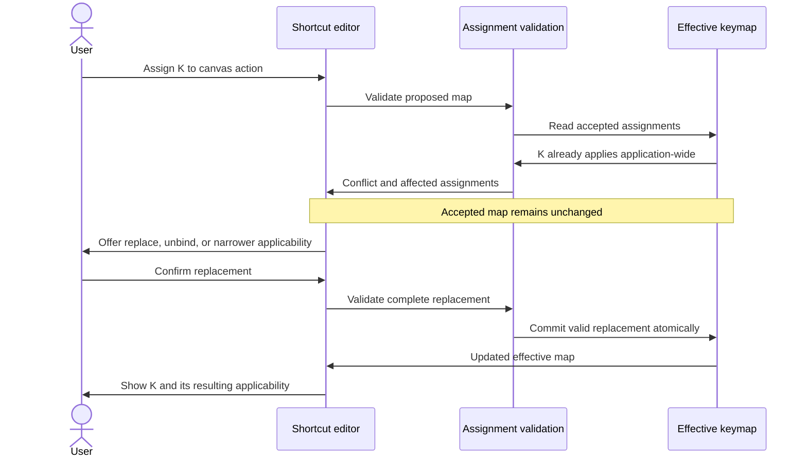
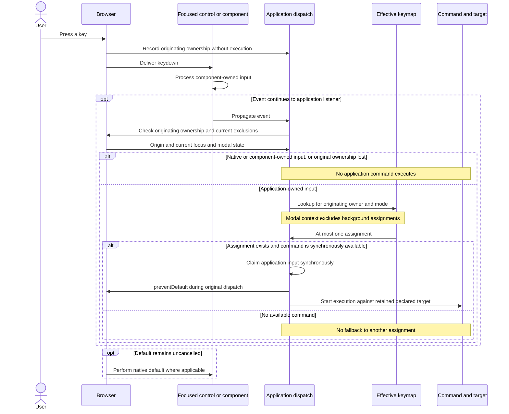
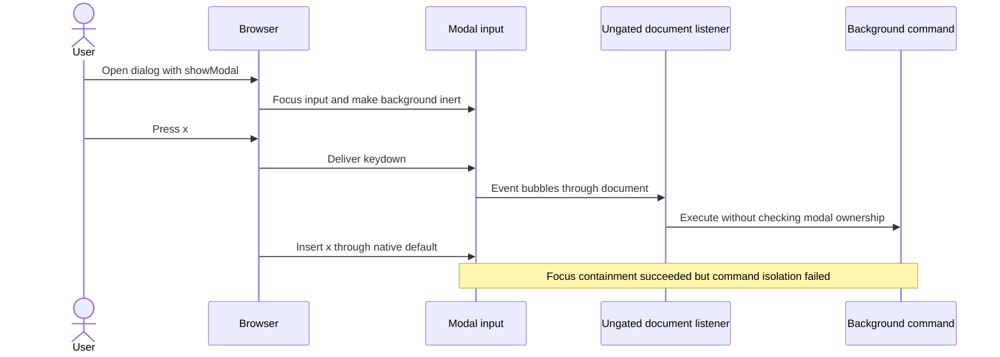

# ADR-KEYBINDINGS-0054: Conflict-free keymaps and native focus ownership

Date: 2026-11-08

## Status

Proposed

## Context

ComfyUI has a graph canvas, editors, viewports, and dialogs that can assign different meanings to the same key. Users need one place to inspect and change those assignments without reasoning about handler registration or extension provenance. A deterministic priority order still leaves competing assignments and makes a binding's effect depend on hidden rules.

The browser already provides focus, text editing, standard control behavior, and modal interaction. Application shortcuts must cooperate with those owners. Focus containment alone does not isolate shortcuts: keyboard events inside a modal still propagate through document and window listeners.

## Decision

Maintain one effective application keymap. For every reachable focus and mode state, a key sequence has at most one eligible application assignment. Resolve conflicts before activating assignments, never by ranking handlers when a key is pressed.

### Focus determines ownership

Use actual DOM focus to identify the application input owner. DOM ancestry locates that owner; it does not activate a stack of ancestor keymaps. Pointer hover and the last clicked panel do not override focus. Canvas-based editors expose a keyboard-focusable owner. Clicking an editor can focus it, but does not establish a separate active-panel state. When no application owner has focus, only explicitly applicable application-wide assignments can run. Window blur suspends application shortcuts.

Input ownership and command targets are separate. Instance-local commands require a compatible focused owner and target that instance. Commands with nonlocal targets declare their target policy explicitly: Queue Prompt targets the active workflow, while a bookmark command targets its declared bookmark, which may be in another subgraph. Resolve and retain the target when claiming the input. A command with no valid target is unavailable; neither hover nor a fallback canvas supplies one.

Modes that cannot coexist are mutually exclusive eligibility states. A modal excludes background application assignments, including application-wide assignments. Modal commands may opt into that modal's context explicitly. Nonmodal panels remain reachable through normal keyboard navigation.

Use native modal behavior or the existing component library for focus containment, restoration, and dismissal. Do not add a parallel Escape handler that also closes the dialog or changes the background graph. An explicit component integration is required to replace a component-owned key behavior.

Native editing, IME composition, and standard widget keys remain with their control. Application undo is rebindable; text undo remains with the focused editor. Editing-specific application commands require an explicit integration with that editor. Browser and operating-system shortcuts are not promised as rebindable application commands.

### Validate assignments before activation

Commands register independently of key assignments. Core and extension defaults are proposed assignments, subject to the same validation as user edits, imports, resets, and configuration migrations. No registration or settings write may bypass validation of the resulting effective keymap.

Each assignment declares its command, keys, and applicability. Applicability uses a bounded model of focus owners, mutually exclusive modes, modal ownership, and editing state. Arbitrary JavaScript predicates and CSS selector specificity do not determine eligibility. If disjointness cannot be established, treat the assignments as conflicting.

Use the same key normalization for validation and dispatch, including platform modifier aliases. Where applicability overlaps, reject duplicate sequences and any sequence that is a prefix of another. Command availability does not excuse a conflict: disabling one command must not expose another assignment.

Use logical `KeyboardEvent.key` identity for application assignments. Keep physical-key declarations inactive until explicitly translated during migration. Commands declare one-shot, repeatable, or held input behavior. One-shot commands ignore repeat events, repeatable commands accept them, and held actions start once. Repeat handling does not select another assignment.

A conflict requires explicit replacement, unbinding, or narrower applicability. Replacement removes or narrows every conflicting assignment and validates the whole result before committing it. An invalid edit or import leaves the current valid keymap unchanged. The same keys may perform different actions only in contexts that cannot be eligible together.

Validate the complete set of known default proposals after each registration batch. Automatically activated defaults remain provisional. A later conflict deactivates every conflicting provisional default, regardless of arrival order. An accepted assignment is an explicit user choice, including one restored from saved configuration. Later proposals cannot displace accepted assignments without confirmation and remain visibly inactive instead. Explicit unbindings survive default updates. Source provenance is diagnostic metadata, never dispatch priority.

The proposed assignment flow handles ambiguity while the user edits the map. The effective map changes only after the complete replacement passes validation.

### Show the effective map in one interface

The shortcut editor presents one flat assignment list with keys, command, human-readable applicability, target, and status. It includes inactive conflicts and unavailable commands. A current-context view identifies the focused owner and shows what each application binding would do, or that native input owns the interaction. Users do not need to understand scope depth, handler order, or which package registered a command.

The editor uses the same validated keymap and eligibility rules as dispatch. For example, assigning a canvas-only key already used by an application-wide command requires a visible configuration change. Focusing the canvas cannot silently make the canvas assignment win.

Workflow-stored shortcuts remain workflow declarations, not copies in account preferences. The flat interface identifies and edits those declarations through the workflow's normal edit and undo path. Loading, duplicating, editing, or removing entities updates their proposed assignments through the same validation before activation. Duplicating a bookmark cannot silently take over its original shortcut. Entity removal withdraws its contribution and releases any held action targeting it.

### Dispatch without arbitration

Let focused controls and component handlers process their input before application shortcut execution. Respect consumed events and native ownership. Execute the unique eligible assignment, or execute no application command. Do not fall through to another binding when a command is unavailable.

Retain the input's originating ownership before component processing. Observing ownership during capture does not execute a command. Component processing may remove eligibility but cannot grant a newly focused owner eligibility for that same keydown. Closing a modal or restoring background focus must not expose a background shortcut to the dismissing key. An explicit editor integration may commit its field and invoke a declared command against its captured target.

Decide synchronously whether an application assignment handles the input. For a handled assignment, prevent the browser default during the original event dispatch, before starting command execution. Do not await command completion or success to make that decision. A recognized pending sequence may also prevent the default in an application-owned context. Do not stop propagation globally to enforce listener order. Cancel pending sequences when ownership changes; never transfer an unfinished sequence to a new owner.

A held action retains its original target. Release it exactly once on key-up, focus or mode loss, modal exclusion, window blur, or target removal. Changing owners does not start an action from a key that was already held. Entity systems handle commands against their declared targets. Entities may contribute workflow shortcut declarations, but do not register competing physical-key listeners or maintain a parallel user keymap.

One assignment may invoke a composite command. Copy, paste, and delete apply one graph operation across the participating entity kinds, including extension-provided groups. Their systems contribute to that operation without separately interpreting its physical key. Consuming the input must not discard part of a mixed core/extension selection.

These are proposed responsibilities, not names of implemented APIs. The native-input branch leaves the browser default intact even when the event reaches the application listener. The application branch has no winner-selection step.

### Migrate without claiming control over arbitrary listeners

Move core and extension application shortcuts through this keymap. Preserve unknown stored assignments as inactive data with a visible reason. They must not execute through an unvalidated fallback dispatcher.

Legacy document and window listeners, canvas or node callback wrappers, and undo veto hooks can bypass focus policy and uniqueness. Provide migration guidance and identify incompatible extensions. Retire interception and its fallback patches together; removing a veto hook must not activate a tracker patch instead. A compatibility path cannot claim the conflict-free guarantee while independent listeners can still execute the same input. Capture-first execution and extension ranking are not substitutes for that migration.

Preserve component-local autocomplete and custom editor history through explicit integrations. Replace invisible-textarea keyboard traps with focusable editor owners rather than pack-specific exceptions in core. Physical-key observation for pointer gestures is separate from application command dispatch. Migrate held commands and their release observers together so neither duplicate nor missing cleanup remains.

### Simplify existing responsibilities

Reuse the command registry and keybinding store rather than adding a second input framework. Consolidate application shortcut recognition into one dispatch path; remove canvas-first execution, hardcoded history shortcut recognition, and Escape override ordering as their consumers migrate. Retain history recording, command execution, and component-owned editing. Native or library modal dismissal replaces the application's parallel close-all-dialogs fallback.

Use one assignment validation boundary for editor changes, presets, resets, workflow contributions, and extension registration. The editor and dispatcher read the resulting effective map instead of reconstructing overlay or replacement policy independently. Retain declaration provenance, saved user choices, and explicit unbindings for persistence and diagnostics. One flat interface does not mean discarding that configuration data.

Focused instance commands replace selected-node keyboard broadcasts; composite graph commands still operate on the complete selection. Use declared modal ownership instead of repeatedly inferring legacy modal visibility once those surfaces migrate. Do not delete legacy detection while unmigrated dialogs still depend on it. The simplification removes duplicate command interpretation, not focus management, ownership observation, or held-action lifetimes.

## Alternatives considered

- Scope depth, source priority, and registration-order tiebreaks make conflicts deterministic but require users to understand hidden precedence.
- Warning about conflicts while retaining both assignments leaves dispatch to choose a winner and defeats the editor's account of the effective map.
- Focus trapping every panel restricts keyboard navigation and still does not stop document listeners. Focus containment belongs to modal interaction.

### Runtime ranking versus a validated map

The ranking branch summarizes the [original ADR proposal](https://github.com/Comfy-Org/ComfyUI_frontend/pull/21984) at [the reviewed commit](https://github.com/Comfy-Org/ComfyUI_frontend/commit/627b3915daf2ab52ec396bc36a3abd86691e0352), not implemented behavior. A warning-only editor still needs runtime arbitration if it retains competing assignments. Both models need native ownership checks and held-action cleanup. The replacement moves conflict resolution to configuration rather than eliminating that work.

```mermaid
flowchart TB
    subgraph ranked["Alternative: keep competing assignments"]
        rankInput["Application-owned keydown"]
        rankMatches["Collect matching scopes and conditions"]
        rankDepth["Compare scope depth"]
        rankSource["Compare source and foreign-extension exception"]
        rankTie["Apply deterministic tiebreak"]
        rankExecute["Execute winning assignment"]
        rankInput --> rankMatches --> rankDepth --> rankSource --> rankTie --> rankExecute
    end
    subgraph unique["Proposed: reject ambiguity before activation"]
        uniqueInput["Application-owned keydown"]
        uniqueContext["Identify focused owner and mode"]
        uniqueLookup["Lookup validated effective map"]
        uniqueExecute["Execute unique available assignment or none"]
        uniqueInput --> uniqueContext --> uniqueLookup --> uniqueExecute
    end
```

### Why focus containment alone is insufficient

This deliberately ungated native-dialog example illustrates the limit of focus containment. Focus remains in the modal, but the document listener still receives the key. The replacement prevents the background command by making its assignment ineligible, while leaving native modal behavior intact.

## Consequences

Users resolve ambiguous assignments in configuration, where the effect is visible. Native controls keep their established behavior. Repeated viewport instances share command definitions, with focus selecting the target for instance-local commands. Nonlocal targets remain explicit.

Some defaults and imported assignments need user resolution before activation. The application must maintain an explicit, bounded eligibility model and validate all assignment changes against it. Extensions with independent listeners require migration; this decision does not establish a security boundary against arbitrary extension JavaScript.

## Acceptance criteria

- An overlapping assignment or prefix conflict cannot activate through any configuration entry point. A rejected change preserves the valid keymap.
- The same key can serve two exclusive modes, but an application-wide and a focused-panel assignment cannot overlap without explicit resolution.
- For the same proposals and user choices, registration order does not change the effective keymap. Conflicting provisional defaults remain visibly inactive, including those contributed in later batches.
- A modal prevents background commands while preserving its focus and dismissal behavior. Text editing, composition, and standard widget keys remain local.
- Closing a modal or blurring a field during keydown cannot redirect that key to a new owner. Capturing ownership does not execute an application command.
- The current-context view and dispatch agree on command and target. Unavailable commands do not reveal hidden fallback assignments.
- Instance-local commands require compatible focus; Queue Prompt and bookmark commands retain their explicit nonlocal targets.
- Mixed core/extension selections participate in one copy, paste, or delete operation through one assignment.
- Workflow contribution edits use workflow history; entity duplication and removal cannot bypass conflict validation or retain a removed target's held action.
- Logical-key migration and one-shot, repeatable, and held behavior are explicit; physical-key declarations are never silently reinterpreted.
- Ownership loss releases held actions once and cancels pending sequences.

## References

- [HTML dialog](https://developer.mozilla.org/en-US/docs/Web/HTML/Reference/Elements/dialog) and [Reka Dialog](https://reka-ui.com/docs/components/dialog) describe modal focus and dismissal behavior, not isolation from document listeners.
- [NbClassic shortcut editing](https://github.com/jupyter/nbclassic/blob/173fdfecbda8e4e6a70d865fda7970ceb5239137/nbclassic/static/notebook/js/shortcuteditor.js) and [mode dispatch](https://github.com/jupyter/nbclassic/blob/173fdfecbda8e4e6a70d865fda7970ceb5239137/nbclassic/static/notebook/js/keyboardmanager.js) provide partial precedents for rejecting occupied assignments and selecting exclusive modes. Programmatic registration can bypass editor validation.
- [Closure's shortcut registry](https://github.com/google/closure-library/blob/b312823ec5f84239ff1db7526f4a75cba0420a33/closure/goog/ui/keyboardshortcuthandler.js) rejects duplicate and prefix-conflicting registrations within one registry. The archived library is a reference, not a dependency recommendation.
