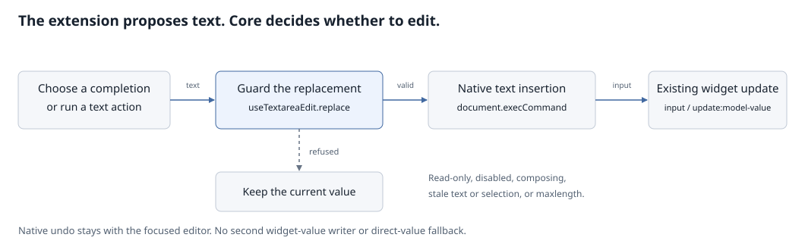

# ADR-WIDGET-AUGMENTATION-0057: Core renders extension contributions

Date: 2026-11-14

## Status

Proposed

## Context

A custom-node author wants to help someone write a prompt, not maintain another
editor. Today that help can require replacing widget factories, attaching DOM
listeners, or assigning widget values. Those integrations inherit each
renderer's selection, focus, undo, and teardown problems. Expanding the same
prompt into a dialog can leave the extension's behavior behind.

## Decision

Let extensions register declarative contributions against named node widgets.
Core resolves active contributions and renders their controls beside the
existing input. Start with completion suggestions, live text hints, and
synchronous text transformations. The devtools example tells this story with
lighting suggestions, a tag count, and a Normalize tags action on one ordinary
multiline widget, leaving its neighboring notes field alone.

Registration supplies behavior without handing the extension an input element.


An accepted suggestion or transformation goes through core's guarded native
editing operation, then the input's existing value pipeline. There is no second
widget-value writer. The node editor and expanded editor share contributions,
not selection or browser undo history. Refusing an edit leaves the value intact.



## Migration stories

**Custom Scripts could keep its dictionaries and stop owning the input.** Its
[autocomplete integration](https://github.com/pythongosssss/ComfyUI-Custom-Scripts/blob/609f3afaa74b2f88ef9ce8d939626065e3247469/web/js/autocompleter.js)
replaces the string-widget factory and attaches an autocomplete engine to each
eligible textarea. Already-loaded words could supply completion providers for
explicit widget targets. This migrates cached lookup, not its global widget
discovery, rich dropdown, or custom escaping and insertion rules.

**Impact Pack could offer prompt help without mutating prompt widgets.** Its
[wildcard integration](https://github.com/ltdrdata/ComfyUI-Impact-Pack/blob/9e2d41da75c185bf7638f860d5d004035f378e9b/js/impact-pack.js)
appends wildcard and LoRA tokens through combo callbacks and writes guidance
directly to textareas. Cached wildcard tokens could supply completions for
`ImpactWildcardProcessor.wildcard_text` and
`ImpactWildcardEncode.wildcard_text`; static guidance could become hints.
Completion would be a different discovery UI, not a drop-in combo replacement.
Population, serialization overrides, and mode-dependent editability stay
outside this API. These are source-based migration candidates, not tested
migrations or promises of full compatibility.

### VideoHelperSuite could stop owning its path dialog

A user starts with Video Combine's output filename. VHS already explains that
the prefix supports subfolders and format strings. After core supports
single-line string hosts, that short explanation could become a targeted
`hint` on `VHS_VideoCombine.filename_prefix`. An optional text action could
append a literal date template. This would be a new convenience, not a
replacement for VHS's queue-time template expansion. The stored value must
remain a template rather than today's resolved date. VHS would retain its
serialization hook and longer node help.

The user then opens Load Video (Path). Today VHS creates a search dialog,
fetches directory entries, handles navigation, and commits the chosen path
through the widget callback. A core-owned path editor could take over that
interaction while VHS supplies directory lookup and filtering. The maintainer
could remove the custom dialog and path drawing for migrated targets, but
retain the callback that refreshes the video preview.

The same contribution could target `VHS_LoadVideoPath.video`,
`VHS_LoadVideoFFmpegPath.video`, `VHS_LoadImagePath.image`,
`VHS_LoadImagesPath.directory`, and `VHS_LoadAudio.audio_file`, with each
target's own file filter. `VHS_SelectLatest.filename_prefix` is different:
it accepts a prefix, not necessarily an existing file. Completion must remain
optional. Video path nodes also accept URLs, and relative paths resolve on
the backend. Core must not turn suggestions into an input allowlist or a
browser-side filesystem policy.

The maintainer stops before migrating numeric widgets. Source-frame-rate and
available-frame-count annotations depend on media metadata and other widget
values. Reset and Disable operate on constrained numbers. Timestamp parsing
and dynamic encoder controls need other contracts. Uploads, previews, virtual
node behavior, and serialization remain outside text augmentation.

This is a source-based migration proposal, not a tested migration. VHS declares
these string inputs without multiline hosting, so even the hint needs a new
host. Its existing behavior is recorded in the
[path dialog and widget integrations](https://github.com/Kosinkadink/ComfyUI-VideoHelperSuite/blob/4d907bee61e92c2e65af3bd6383a4e4d356126d1/web/js/VHS.core.js),
[node schemas](https://github.com/Kosinkadink/ComfyUI-VideoHelperSuite/blob/4d907bee61e92c2e65af3bd6383a4e4d356126d1/videohelpersuite/nodes.py),
[video and image path schemas](https://github.com/Kosinkadink/ComfyUI-VideoHelperSuite/blob/4d907bee61e92c2e65af3bd6383a4e4d356126d1/videohelpersuite/load_video_nodes.py),
[image-directory schema](https://github.com/Kosinkadink/ComfyUI-VideoHelperSuite/blob/4d907bee61e92c2e65af3bd6383a4e4d356126d1/videohelpersuite/load_images_nodes.py),
and [help text](https://github.com/Kosinkadink/ComfyUI-VideoHelperSuite/blob/4d907bee61e92c2e65af3bd6383a4e4d356126d1/videohelpersuite/documentation.py).

## Proposed path completion extension

This section specifies a follow-up design, not the current runtime contract.
Keep synchronous prompt-token completion unchanged. Add single-line hosting
for existing hints and text actions, and a separate `path-completion` kind
for a core-owned path editing session. Reuse the existing registration list
and exact node/widget targets. Do not expose a node, input element, renderer,
or mount callback to the provider.

### Provider usage and shape

A VHS registration supplies lookup and parent-path functions. The extension
captures the target's extension filter and backend API client in those
functions. It does not need per-node context for this behavior.

```ts
const videoPathCompletion = {
  id: 'video-path',
  kind: 'path-completion',
  target: { nodeType: 'VHS_LoadVideoPath', widgetName: 'video' },
  suggest: suggestVideoPaths,
  parent: parentVhsPath
} satisfies PathCompletion
```

The proposed additional union member has this shape:

```ts
type PathSuggestion = {
  label: string
  value: string
  kind: 'directory' | 'file'
}

type PathSuggestions =
  | { status: 'ready'; items: readonly PathSuggestion[] }
  | { status: 'unavailable' }

type PathCompletion = {
  id: string
  target: WidgetAugmentationTarget
  kind: 'path-completion'
  suggest: (
    value: string,
    options: { signal: AbortSignal; showAllFiles: boolean }
  ) => Promise<PathSuggestions>
  parent: (value: string) => string
}
```

`suggest` receives the complete draft, including an empty value. The provider
splits the directory from the filename fragment, requests entries, applies
the target's filter unless `showAllFiles` is true, and returns ordered matches.
Each `value` is a complete replacement, not a suffix for core to concatenate.
`label` is plain display text, never HTML. `parent` returns the parent-directory
draft, leaving root handling and backend path syntax with VHS.

VHS keeps its existing
[directory endpoint](https://github.com/Kosinkadink/ComfyUI-VideoHelperSuite/blob/4d907bee61e92c2e65af3bd6383a4e4d356126d1/videohelpersuite/server.py)
and [path policy](https://github.com/Kosinkadink/ComfyUI-VideoHelperSuite/blob/4d907bee61e92c2e65af3bd6383a4e4d356126d1/videohelpersuite/utils.py).
The adapter reconstructs full replacement values from returned entry names.
Expected lookup failures return `unavailable`, not a claim that the typed path
is invalid. Cache ownership stays with the provider; a cache must separate
directory, filter, and backend connection. A cache is not required by the API.

### Core owns the draft and commits once

Opening the path editor snapshots the widget value into a local draft.
Typing, completion, parent navigation, and the Show all files toggle affect
only that draft. They do not write the widget or refresh its preview.
Core supplies a single-line native input, a result list, Up and Show all files
controls, and explicit confirmation and cancellation. `showAllFiles` starts
false in each session and stays true after enabling it, including across
directory navigation.

- Clicking a directory replaces the whole draft and requests its children.
  Confirming the draft can still select that directory.
- Clicking a file replaces the draft and confirms it. Enter and the confirm
  control accept the current free-form draft, including a URL or prefix.
- Tab fills the active result into the draft and refreshes suggestions without
  confirming it. The first result is initially active, matching VHS's default.
  Arrow keys change that result without editing the draft. With no results,
  Tab keeps normal focus navigation. Shift+Tab retains backward focus
  navigation.
- Escape, dismissal, or host removal cancels the edit. Core does not commit on
  blur. Ctrl+B or Ctrl+W invokes Up, and Ctrl+G enables Show all files, only
  while the editor owns focus and the browser permits interception. Visible
  controls remain available when the browser reserves these shortcuts.
- Confirmation checks that the widget is still editable and its original
  value is unchanged, then uses the existing widget update path exactly once.
  A changed value invalidates the session rather than overwriting another
  edit. An unchanged draft closes without a redundant update.

Programmatic draft replacements must preserve native input undo, composition,
selection, and maxlength behavior. They use guarded native editing rather
than an assignment fallback. Unsupported replacement leaves the draft intact.
Only a successful replacement can trigger file confirmation or directory
navigation. Draft undo and graph undo are separate: cancelling creates no
graph edit; confirmation creates one ordinary widget edit. Cross-browser
verification is required before enabling this host.

Each lookup belongs to a session and request generation. Core aborts the
previous request and clears its selectable results when the draft or filter
changes. It also checks generation before applying results, because a provider
may ignore cancellation. Cancellation, composition start, read-only
transitions, removal, unregistration, and backend changes invalidate outstanding
work. Composition pauses lookup, navigation, and confirmation until it ends.
An unavailable outcome shows a retry control without blocking free-form
confirmation or disabling the provider. Unexpected provider exceptions and
malformed results are reported once and disable provider operations for that
session, while leaving manual editing available.

A path editing session has one path provider per exact target. Conflicting
registrations disable path enhancement for that target and report the conflict;
core must not silently choose an extension or merge incompatible path grammars.
Do not run prompt-token providers inside this session. Path results use a
scrollable list, not prompt completion's silent eight-result truncation.

### Why a separate kind is smaller

Adding only a Promise return to `text-completion` still leaves prompt token
boundaries, its minimum query length, immediate widget edits, and its Tab
policy. Supporting paths there would require independent switches for those
behaviors and for draft confirmation. A separate kind keeps those policies
together without changing existing prompt providers.

A core filesystem browser with `list(directory)` would have fewer callbacks,
but would put backend path splitting, full-value reconstruction, and parent
navigation in core. Returning complete replacements and supplying `parent`
keeps that knowledge in VHS. We accept one extra pure function to avoid a
core-owned path dialect. A provider chooser would support competing browsers,
but is unnecessary for migrating VHS, so conflicting registrations fail closed
to manual editing. Arbitrary UI mounting would preserve VHS's
dialog but return keyboard, focus, undo, and cleanup to the extension author.
No new editor or autocomplete dependency is needed for this design.

### Migration and verification gates

Implement the core-owned single-line session before replacing VHS's widget
factory for selected targets. A migrated target must use either the old VHS
dialog or the new contribution, never both. Older frontends retain the old
integration; rollout requires an explicit supported-capability check rather
than assuming registration means the contribution can render.

The migration must demonstrate these observable outcomes:

- Browse from an empty draft, navigate down and up, then cancel. The original
  widget, preview, and workflow remain unchanged.
- Complete a path containing a comma or semicolon with the caret in the
  middle. The result replaces the whole draft without retaining its suffix.
- Return an older filtered request after a newer unfiltered request. Only
  the latest result list can be selected, even if abort was ignored.
- Confirm a file, a directory, a URL, and a partial filename prefix. Each
  reaches the normal widget callback once and keeps backend validation.
- Exercise Tab, Enter, composition, no results, lookup failure, read-only
  changes, extension removal, and an externally changed widget value.
- Undo completion inside the draft and undo confirmation in the workflow.
  Queue a filename template twice without replacing its stored expression.

Numeric annotations, arbitrary components, pagination, and a general query
grammar remain outside this extension. Large-directory behavior needs a
bounded runtime check before rollout; this design makes no performance claim.

## Tradeoffs and limits

Keep native textareas instead of replacing prompt editing with a rich editor.
Reuse existing positioning and design-system controls instead of adding an
autocomplete library. A general mount callback would admit arbitrary UI, but
would also require a public focus, keyboard, accessibility, and edit-lifecycle
contract. Defer that until a concrete contribution cannot fit this model.

The implemented prototype covers multiline native textareas, not the proposed
path session, every widget, or the agent's structured ProseMirror editor.
Its exact targets and synchronous callbacks deliberately limit discovery and
remote suggestions. Native insertion still depends on deprecated `execCommand`.
Core skips unsupported insertion to preserve undo. Cross-browser undo and
automatic loading of the built devtools extension remain release gates.
Existing extension behavior is not removed or intercepted by this proposal.
