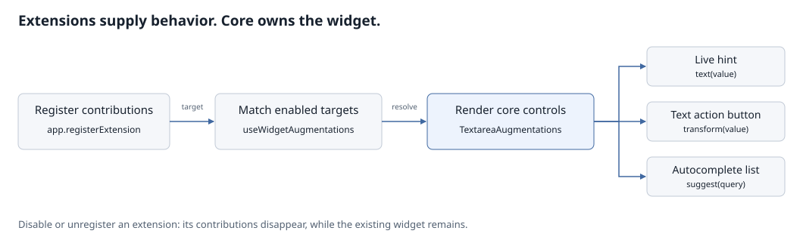

# ADR-WIDGET-AUGMENTATION-0057: Core renders extension contributions

Date: 2026-11-14

## Status

Proposed

## Context

A custom-node author wants to help someone write a prompt, not maintain another
editor. Today that help can require replacing widget factories, attaching DOM
listeners, or assigning widget values. Those integrations inherit each
renderer's selection, focus, undo, and teardown problems. Expanding the same
prompt into a dialog can leave the extension's behavior behind.

## Decision

Let extensions register declarative contributions against named node widgets.
Core resolves active contributions and renders their controls beside the
existing input. Start with completion suggestions, live text hints, and
synchronous text transformations. The devtools example tells this story with
lighting suggestions, a tag count, and a Normalize tags action on one ordinary
multiline widget, leaving its neighboring notes field alone.

Registration supplies behavior without handing the extension an input element.

An accepted suggestion or transformation goes through core's guarded native
editing operation, then the input's existing value pipeline. There is no second
widget-value writer. The node editor and expanded editor share contributions,
not selection or browser undo history. Refusing an edit leaves the value intact.

## Migration stories

**Custom Scripts could keep its dictionaries and stop owning the input.** Its
[autocomplete integration](https://github.com/pythongosssss/ComfyUI-Custom-Scripts/blob/609f3afaa74b2f88ef9ce8d939626065e3247469/web/js/autocompleter.js)
replaces the string-widget factory and attaches an autocomplete engine to each
eligible textarea. Already-loaded words could supply completion providers whose
predicate targets select eligible prompt widgets. This migrates cached lookup, not its global widget
discovery, rich dropdown, or custom escaping and insertion rules.

**Impact Pack could offer prompt help without mutating prompt widgets.** Its
[wildcard integration](https://github.com/ltdrdata/ComfyUI-Impact-Pack/blob/9e2d41da75c185bf7638f860d5d004035f378e9b/js/impact-pack.js)
appends wildcard and LoRA tokens through combo callbacks and writes guidance
directly to textareas. Cached wildcard tokens could supply completions for
`ImpactWildcardProcessor.wildcard_text` and
`ImpactWildcardEncode.wildcard_text`; static guidance could become hints.
Completion would be a different discovery UI, not a drop-in combo replacement.
Population, serialization overrides, and mode-dependent editability stay
outside this API. These are source-based migration candidates, not tested
migrations or promises of full compatibility.

### VideoHelperSuite could stop owning its path dialog

VHS's Load Video (Path) and related nodes open a custom search dialog that
fetches directory entries, handles navigation, and commits through the widget
callback
([source](https://github.com/Kosinkadink/ComfyUI-VideoHelperSuite/blob/4d907bee61e92c2e65af3bd6383a4e4d356126d1/web/js/VHS.core.js)).
A `path-completion` contribution could replace that dialog while VHS keeps its
directory endpoint, file filters, and path policy. Numeric annotations,
uploads, previews, and serialization stay outside this API. This proposal
comes from reading the VHS source; nobody has tested the migration.

## Path completion

Add a separate `path-completion` kind instead of making `text-completion`
asynchronous. Prompt completion edits the widget immediately at token
boundaries; path completion edits a draft and commits once. One kind with
switches for both policies would be larger than two kinds.

The provider supplies `suggest(draft, { signal, showAllFiles, widget })`, which returns
complete replacement values or `unavailable`, and a pure `parent(draft)`.
Returning complete values and a parent function keeps backend path syntax in
the extension instead of a core-owned path dialect. Core owns the draft,
cancellation, stale-result rejection, and the single commit. Manual entry
always works, including when lookup fails. When two providers target one
widget, core falls back to manual editing and picks neither. We rejected
arbitrary UI mounting because it would hand keyboard, focus, undo, and cleanup
back to the extension author.

The prototype hosts single-line STRING widgets in Vue Nodes 2.0 only. Legacy
canvas widgets stay manual. Cross-browser native-input undo and a real VHS
integration are release gates.

## Targeting

A `target` is either an exact `{ nodeType, widgetName }` or a predicate that
receives the same pair for each hosted widget. Exact targets suit authors who
augment their own nodes. A predicate lets one registration cover a family of
widgets, such as every VHS path input, without listing each node. Path
providers also receive the widget they serve, so one provider can apply each
widget's file filter. Core already decides which kinds a host renders: prompt
help on multiline textareas and path completion on single-line fields, so a
predicate only picks widgets within that host.

Core evaluates predicates when a host mounts or the registered extensions
change. When a predicate throws, core treats it as matching no widget and
reports the error once. We considered new widget types for author-owned
widgets. Those need a backend schema change for every node, and they cannot
reach core prompt widgets.

## Tradeoffs and limits

Keep native textareas instead of replacing prompt editing with a rich editor.
Reuse existing positioning and design-system controls instead of adding an
autocomplete library. A general mount callback would admit arbitrary UI, but
would also require a public focus, keyboard, accessibility, and edit-lifecycle
contract. Defer that until a concrete contribution cannot fit this model.

The implemented prototype covers multiline native textareas and single-line
path fields, not every widget or the agent's structured ProseMirror editor.
Prompt callbacks stay synchronous. Native insertion still depends on deprecated `execCommand`. Core
skips unsupported insertion to preserve undo. Cross-browser undo remains a
release gate. This proposal does not remove or intercept existing extension
behavior.
