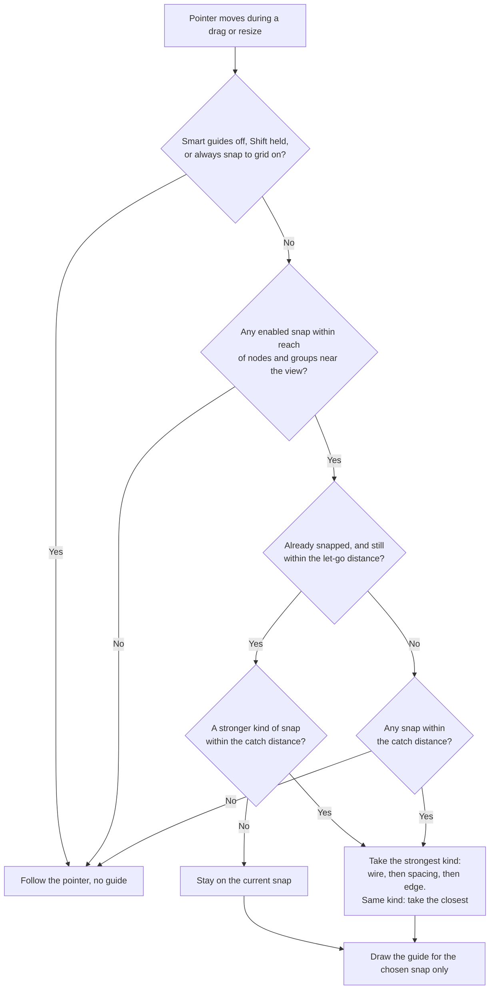

# Smart guides

Smart guides help you line nodes and groups up while you drag or resize them.
When an edge, centre, wire, or gap is close to lining up with something
nearby, the item jumps the last few pixels and a guide shows what it lined up
with. The Align popover in the selection toolbox does the same kind of
arranging in one click for several selected nodes.

## What a user can do

| You want to                                             | You do                                                                                 | What happens                                                                                                                                                  |
| ------------------------------------------------------- | -------------------------------------------------------------------------------------- | ------------------------------------------------------------------------------------------------------------------------------------------------------------- |
| Line a node up with a neighbour                         | Drag it until an edge or centre is close to the neighbour's                            | It snaps into line and a guide joins the two. The guide disappears when you drop.                                                                             |
| Put a node right next to another                        | Drag it beside or below the other                                                      | Its edge snaps against the other's, with the gap from the **Gap when snapping next to another node** setting.                                                 |
| Straighten a wire                                       | Drag a connected node until the wire is nearly level                                   | The node moves up or down so the wire is level. Wires only straighten vertically.                                                                             |
| Line a subgraph's input or output bar up with its wires | Inside a subgraph, drag the input or output bar until one of its wires is nearly level | The bar moves up or down so that wire is level. The bar only snaps to its own wires, never to node edges or spacing, and nodes never snap to the bar's edges. |
| Repeat the spacing of a row                             | Drag a node near the end of, or between, evenly spaced nodes                           | It snaps to the same gap and the guide shows the equal gaps.                                                                                                  |
| Resize a node or group to match a neighbour             | Drag a corner until an edge is close to a neighbour's                                  | Only the edges you are dragging snap. The opposite corner stays put, and a snap never makes the item smaller than its minimum size.                           |
| Place something exactly where you drop it               | Hold **Shift** while dragging or resizing                                              | Smart guides stay out of the way; Shift snaps to the grid instead.                                                                                            |
| Turn one kind of snap off                               | Settings → LiteGraph → Smart Guides                                                    | Edge, wire, and spacing snaps each have their own switch.                                                                                                     |
| Turn smart guides off                                   | Turn off **Snap to nearby nodes, groups, and wires**                                   | Drags and resizes follow the pointer exactly.                                                                                                                 |
| Line several nodes up at once                           | Select them and open **Align** in the selection toolbox                                | See [The Align popover](#the-align-popover).                                                                                                                  |

Smart guides also stay off while **Always snap to grid** is on, and while the
older Smart Guides extension (`nomadoor.SmartGuides`) is installed and enabled,
so two snapping systems never fight over the same drag. Pinned items never
move, so they never snap.

## How a snap is chosen

Each time the pointer moves, the item's horizontal position is decided first
and its vertical position second, by the same rules:

The words in the tree mean this:

- **Within reach.** The solver only looks at nodes and groups in and around
  the visible part of the canvas, so far-away nodes never pull the item.
- **Catch distance and let-go distance.** The **Snap distance** setting is in
  screen pixels, so snapping feels the same at every zoom level. A snap catches
  at that distance and lets go only once you pull a little further, so the item
  does not flicker between snapped and free near the edge.
- **Stronger kind.** A straight wire beats even spacing, which beats lining up
  edges. A stronger snap can take over from a weaker one you are already
  holding; a weaker one never can.
- **Valid snaps only.** Putting a node right next to another only counts when
  the two overlap across the other direction, as they would side by side.
  Spacing snaps only count when the node overlaps the row it is joining and,
  between two neighbours, fits in the gap.
- **Both directions together.** If moving the item vertically makes its
  horizontal snap invalid, the horizontal snap is dropped and chosen again.
- **One guide.** Only the snap that won draws a guide. When several nodes share
  the line, the guide runs to the nearest of them.

Resizing follows the same tree with two differences: only edge snaps apply,
and only the edges being dragged can snap.

## The Align popover

The Align popover acts on the selected nodes that are not pinned.

- **Align** left, right, top, or bottom edges lines every node up with the
  outermost edge in that direction. Aligning centres lines them up on the middle
  of the whole selection. It needs at least two nodes.
- **Match width** and **Match height** make every node as wide or as tall as
  the largest one. Collapsed and non-resizable nodes are left out.
- **Distribute** horizontally or vertically evens out the gaps and keeps the
  first and last nodes where they are. It needs at least three nodes.
- Every action is a single undo step, and every button is disabled on a locked
  canvas or when there are too few nodes for it to act on.

After distributing a single row, gap handles appear between the nodes. Dragging
one, or pressing the arrow keys on it (Shift for bigger steps), changes every
gap in the row at once, and each change is one undo step. The handles go away
when the selection changes, when the nodes are pinned, or when **Tidy up**
replaces them with its own. Distributing nodes that overlap, or nodes that sit
in more than one row, shows no handles.
