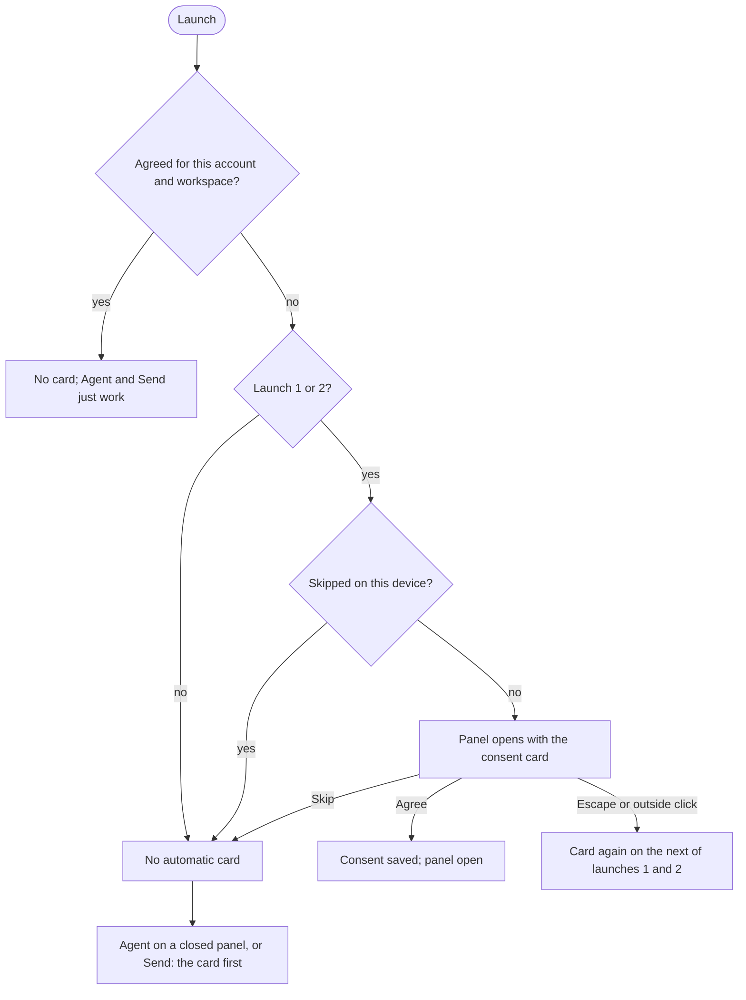

# In-App Agent panel (FE-1187)

The In-App Agent panel is a manager-pattern workbench extension. The panel lives
entirely in this subtree and renders in a right dock registered by
`src/extensions/core/agentPanel.ts`, so it shares the host pinia and vue-i18n
instances and wires every host dependency itself (REST client, agent events
socket, draft-to-canvas seam).

## Backend contract

The panel speaks one contract on the cloud and on the local agent:

- **Events socket, `/api/agent/events`** (`services/agent/agentEventSource.ts`).
  Agent events and CRDT doc frames share it in both directions; ComfyUI's
  `/ws` carries neither. Its URL comes from `api.apiURL`. In the cloud it
  takes the auth params `/ws` uses, and does not open when no one is signed
  in; elsewhere the signed-in user's credential rides as `?token=`. Both are
  read again on every connect. Reconnects back off with jitter; the backoff
  resets once a socket delivers a frame or stays open for the maximum delay.
- **Identity, `GET /api/agent/identity`** (`services/agent/agentIdentity.ts`).
  Canvas ops carry `human:<user_id>:<tab>` with the id the backend reports,
  so the follower stays inactive until it answers. A failed lookup retries
  with backoff, capped at 30 seconds and never given up, and at once when the
  socket connects again. A rejected credential is not retried until the
  account changes.
- **ComfyUI restart** (`stores/agent/agentNodeDefinitionRefreshStore.ts`). A
  successful `restart_comfyui` tool call means ComfyUI restarts once the turn
  ends. Every `/ws` reconnect within 10 minutes of that call, before or after
  it, refreshes node definitions and then reloads the open workflow, because
  the call and the reconnect arrive on different sockets in either order. An
  unrelated reconnect in that window refreshes too and leaves the restart's
  own reconnect to refresh again. The refresh shows its own "Update requested"
  and "Node definitions updated" toasts. A failed refresh runs again on the
  next reconnect in the window. A reconnect outside the window does nothing, so
  if none comes within it the store does nothing, and **Refresh Node
  Definitions** recovers definitions. A restart made while the panel is closed
  is not observed here; outside the agent, `platform/customNodes/useReconnectNodeDefinitionRefresh.ts`
  (wired in `GraphView.vue`, local only) checks `/object_info` on every
  reconnect and, when it lists node types the page lacks, refreshes
  definitions and reloads the open workflow if it holds one of them.
- **Saved workflows, `GET /api/workflows`**. Saved tabs resolve through the
  saved-workflow index on every backend.
- **Credential** (`services/agent/agentAuth.ts`). In the cloud, agent requests
  authenticate through `api.fetchApi` like every other request. Elsewhere they
  carry the signed-in user's auth header, or the stored API key when no one is
  signed in, and a running turn re-sends it. A signed-out send opens the sign-in
  dialog, unless the dev proxy injects `DEV_AGENT_COMFY_TOKEN`. Signing out or
  switching account (or API key) reconnects the socket and looks the identity
  up again.

## Activation and consent

The dock is visible when the server's `agent` feature reports
`state: "ready"` and the panel has an open intent; sending still requires
Agent consent for the current user and workspace. Cloud and ComfyUI (`--enable-agent`)
publish the same feature, and ComfyUI pushes `agent_status` when it changes;
while it is `starting` or `failed` the entry button shows that, inert. Builds
with `VITE_AGENT_STANDALONE=true` (the local agent harness) ignore the feature
and, in development mode, force the panel on; consent is still required. A
plain `pnpm dev` shows the panel only when the ComfyUI it proxies publishes the
feature. A restored open intent cannot bypass consent.

Cloud and Desktop share one onboarding rule (ADR-AGENT-CONSENT-0045). On the
first two launches the panel opens by itself, with the consent card over it
until the user answers. After that, **Agent** asks for consent before it opens
a closed panel, and Send asks before the first message. Signed-out users see
the card before sign-in.



On launches 1 and 2 the panel also opens by itself for a user who has agreed;
after that it keeps whatever open state the user left it in.

Acceptance is stored through the hosted Global Settings API under
`Comfy.AgentPanel.ConsentAccepted` for the authenticated user and workspace. Skip, Escape and outside clicks dismiss without accepting.
Skip is remembered on the device for the account and workspace (or for
signed-out use) and ends the automatic card; Escape and outside clicks do not.
Failed loads or saves allow retry and do not permit sending. A manual request
to open a closed panel waits for successful consent; automatic activation can
open the panel before consent.
Switching user or workspace invalidates the cached acceptance and loads the
new scope. Desktop/Local sign-in continuation authenticates before saving.

### Consent offer telemetry

`agent_consent_not_offered` names why an automatic offer was not made.

| `reason`              | Why                                         | Retried                |
| --------------------- | ------------------------------------------- | ---------------------- |
| `first_run_screen`    | Getting Started or another first-run screen | When it closes         |
| `tour_active`         | Another onboarding tour                     | When it ends           |
| `dialog_open`         | Another dialog                              | When it closes         |
| `boot_undecided`      | The startup decision did not settle         | No, for this page load |
| `storage_unavailable` | localStorage cannot be written              | No, for this page load |

`agent_consent_offer_exited` covers every other ending. Split queries by
`exit`; a total is not a quantity.

| `exit`                       | Meaning                                          | Kind                |
| ---------------------------- | ------------------------------------------------ | ------------------- |
| `consent_already_accepted`   | Consent is already stored for this scope         | Correct, not needed |
| `card_already_seen`          | The card was already on screen this page load    | Correct, not needed |
| `activation_window_complete` | Past launch 2, or the launch count is unreadable | Correct, not needed |
| `consent_unresolved`         | The stored consent read has not settled          | Owed, not made      |
| `consent_read_failed`        | The stored consent read failed                   | Owed, not made      |
| `offer_in_flight`            | Another offer attempt has not finished           | Owed, not made      |
| `startup_probe_failed`       | The first-run startup probe failed               | Owed, not made      |
| `scope_changed_before_read`  | The account or workspace changed before the read | Owed, not made      |
| `scope_probe_failed`         | Resolving the account or workspace failed        | Owed, not made      |
| `scope_changed_after_read`   | The account or workspace changed during the read | Owed, not made      |
| `card_closed_before_mount`   | The card closed before it rendered               | Owed, not made      |

There is no exit for "the agent flag is off": it would fire on every page load
outside the rollout, and every event already carries
`$feature/agent-in-app-experience`.

Outside the request stage, exits are deduplicated per page load by
(`stage`, `exit`, `retry_armed`). The request stage records each attempt
without deduplication, including automatic retries after a pre-display hold.
Compare counts within the same stage, exit and retry state; do not sum across
stages.

## First-use tour

After consent succeeds, the first Agent open starts a four-card tour of the
panel, composer, graph and chat history. **Next** advances through the cards;
**Done** on the last card, **Skip** on any card and Escape once a card is on
screen all dismiss the tour and mark it complete.

Completion is device-local in `localStorage`, scoped to the authenticated user
and active workspace; with either unresolved there is no scope to record, so no
tour is shown at all. It does not sync through Global Settings. A different
user or workspace on the same device gets its own tour. The legacy unscoped
completion flag is adopted once by the current scope, then removed.

The tour waits rather than marking itself complete when its target is not yet
available. It is also deferred while App Mode is active or another onboarding
tour owns the overlay; returning to graph mode or finishing the other tour lets
the Agent tour appear.

## CRDT follower

The doc-host follower has no gate of its own: it mounts with the agent panel,
so it runs only once the panel's activation and consent requirements above are
satisfied.
The follower's doc frames ride the events socket
(`crdt/agentDocFrameTransport.ts`), and every open of that socket resubscribes.
The dev server proxies `/api/agent/events` as a WebSocket. To run against a
cloud ephemeral environment:

```bash
DEV_SERVER_COMFYUI_URL=https://<host>/ pnpm dev
```

Incoming `doc_update` frames are decoded and applied incrementally with
`Y.applyUpdate`; the follower never requests or fans out a full document for
each update. Human edits are minted into the shared op vocabulary and sent as
`doc_ops` frames on the same socket (`crdt/docOpMinter.ts`).

While the follower holds the bound document, a turn sends no draft: the
document is the source of truth and an unversioned draft would overwrite it.
Once the follower gives up on that document (refused for good, every subscribe
unanswered, or unreadable), or the identity lookup is rejected, turns seed the
draft again. An identity lookup that is still retrying keeps withholding the
draft. A reconnect retries the document and withholds it until that attempt
settles.

## Ask cards

An `ask_user` question stays on screen, read-only, after it resolves, until
the thread is loaded again. The server's transcript keeps only a pending ask
(`pending_ask`), so a reload, or opening another chat and coming back, drops a
card whose ask has resolved.
